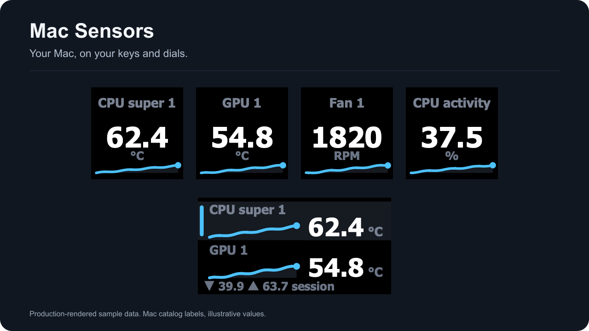
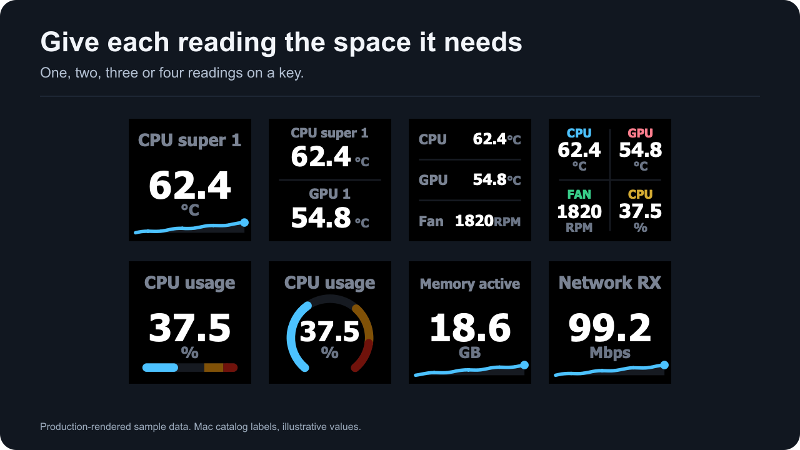
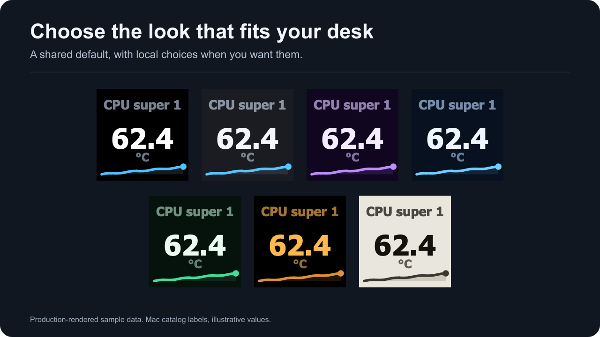
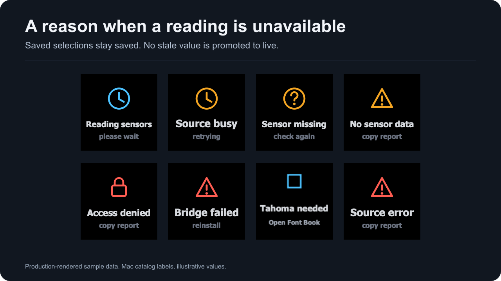

# Mac Sensors

Read-only Mac sensor readings on Stream Deck keys and dials.

[Documentation](https://docs.slawrensen.com/mac-streamdeck/) · [Releases](https://github.com/slawrensen/mac-streamdeck/releases) · [Report a bug](https://github.com/slawrensen/mac-streamdeck/issues)

<em>Your Mac, on your keys and dials. Production-rendered sample data.</em>

The 1.0.0.0 candidate is undergoing its final hardware observation window. Published packages will appear on the Releases page. Physical Intel and device checks are listed in the compatibility documentation.

## Give each reading its space

Show a large number or put two, three or four readings on one key.

*Production-rendered sample data using Mac catalog readings and short custom labels.*

- Pick each reading by its stable identity and give it a label you recognize.
- Use a sparkline, bar or ring where the layout supports it.
- Keep a saved selection when a sensor is temporarily unavailable.

**More:** [Sensor Reading](https://docs.slawrensen.com/mac-streamdeck/sensor-reading.html) · [Getting started](https://docs.slawrensen.com/mac-streamdeck/getting-started.html)

## Open the details

Put a group of readings behind one key and return through a configurable Back tile.

*Production-rendered sample data showing reading cells and navigation.*

- Choose the sensor's group or build a custom list.
- Mix tile densities while labels and colors travel with their readings.
- Use the second Back tile at the opener's position where supported.

**More:** [Sensor details](https://docs.slawrensen.com/mac-streamdeck/sensor-details.html)

## Keep a reading set on a dial

Turn through readings and groups with one-reading, two-row and overview views.

*Production-rendered sample data with local session statistics.*

- Keep missing members saved until the same identity returns.
- Use local session min, max and average from genuine observations.
- Choose a preset or assign the individual controls you need.

**More:** [Sensor Dial](https://docs.slawrensen.com/mac-streamdeck/sensor-dial.html) · [Controls and presets](https://docs.slawrensen.com/mac-streamdeck/dial-controls.html)

## Share a look, keep local choices

Choose a theme for the whole deck or override it on one action.

*Production-rendered sample data with the same reading in each theme.*

- Seven themes include dark options and Paper.
- Make shared applies your choice as the shared default.
- Custom text and per-reading colors remain subordinate to alerts.

**More:** [Themes and colors](https://docs.slawrensen.com/mac-streamdeck/themes.html)

## See a threshold crossing

Warning and critical colors mark the limits you choose for a reading.

*Production-rendered sample data. Alert colors are fixed.*

- Warning is orange and critical is red across themes.
- Gauge zones stay muted the same way the device draws them.
- Alerts change the display; hardware remains read-only.

**More:** [Thresholds and alerts](https://docs.slawrensen.com/mac-streamdeck/thresholds.html)

## Know when data is unavailable

Status screens preserve your selection and name the condition the plugin can establish.

*Production-rendered sample scenarios.*

- Failed or expired readings do not stay live.
- Check again requests a new eligible read.
- A fixed setup image remains available when Tahoma Bold is missing.

**More:** [Status screens](https://docs.slawrensen.com/mac-streamdeck/status-screens.html) · [Troubleshooting](https://docs.slawrensen.com/mac-streamdeck/troubleshooting.html)

## Requirements and scope

macOS 13.5 or later, Stream Deck 7.1 or later, and Tahoma Bold. The package includes separate arm64 and x86_64 readers and uses the app's Node 24 runtime. No privileged helper or separate sensor application is installed.

Sensor availability varies by Mac. The measured M5 Pro catalog includes temperatures, fans, system power, CPU activity, named memory counters, storage space and aggregate transfer rates. CPU/GPU clocks and unqualified private GPU usage are not offered. Key provider statistics are unavailable; dial session statistics are local.

[Hardware compatibility](https://docs.slawrensen.com/mac-streamdeck/hardware.html) distinguishes actual app, hosted CI, Rosetta and physical-device evidence. [PERF.md](PERF.md) records timing windows and their limits. Images above use sample data and do not represent a hardware photograph.

## Privacy and license

The plugin makes no internet requests and sends no telemetry. It reads local macOS interfaces and communicates with the local Stream Deck app. You choose when to copy and share a support report. See the [privacy details](https://docs.slawrensen.com/mac-streamdeck/faq.html#privacy).

Free, MIT licensed, no ads, no telemetry. [License](LICENSE) · [Third-party notices](NOTICE.md) · [Security reporting](SECURITY.md)

Not affiliated with Apple or Elgato. Mac and macOS are trademarks of Apple Inc. Stream Deck is a trademark of Corsair Memory, Inc.
