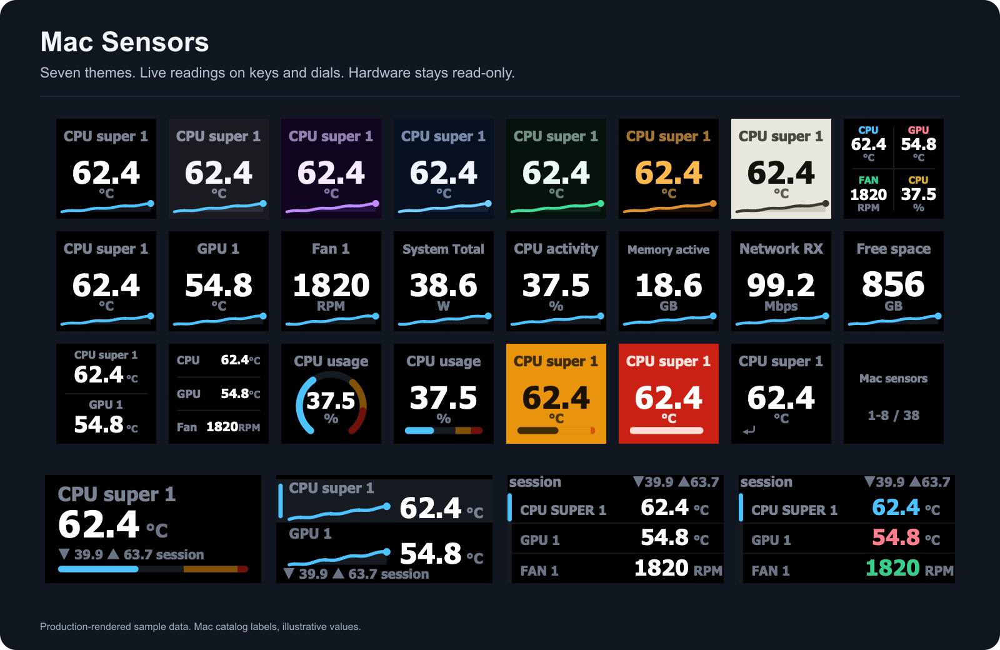
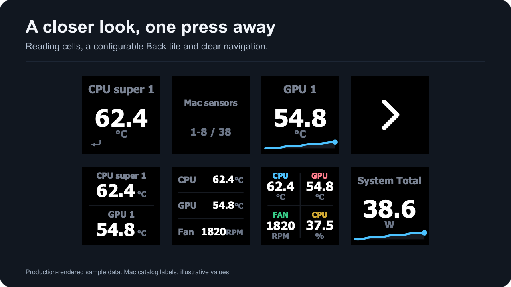
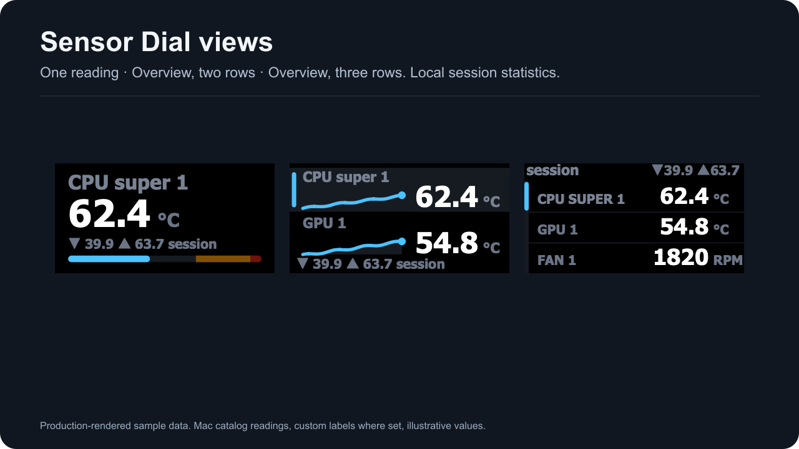
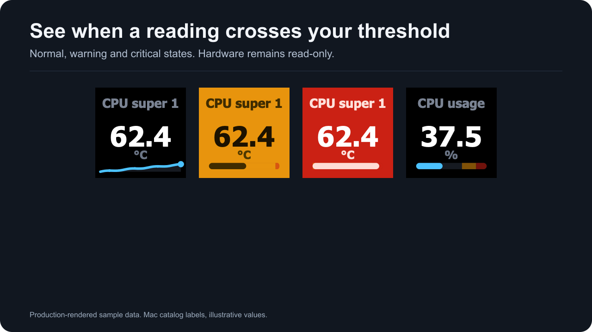
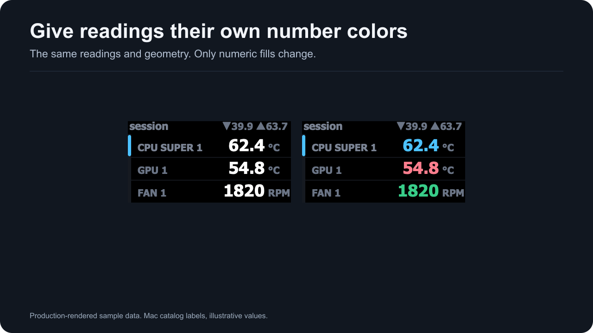
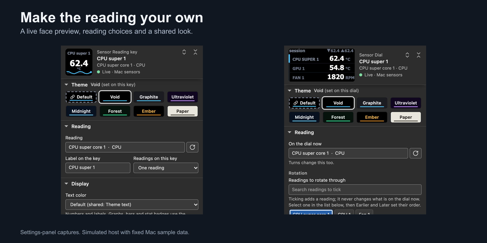

  

  <em>Seven themes · one to four readings per key · sparkline, bar and ring · warning and critical colors · reading sets on dials. Production-rendered sample data.</em>

<h1 align="center">Mac Sensors for Stream Deck</h1>

  <b>Your Mac, on your keys and dials.</b> 
  Temperatures, fans, power, CPU activity, memory and transfer rates through read-only macOS interfaces.

  <a href="docs/index.md">Documentation</a> ·
  <a href="https://github.com/slawrensen/mac-sensors-streamdeck/releases">Releases</a> ·
  <a href="https://github.com/slawrensen/mac-sensors-streamdeck/issues">Report a bug</a>

  <a href="#try-the-candidate">Try it</a> ·
  <a href="#give-each-reading-its-space">Keys</a> ·
  <a href="#open-the-details">Details</a> ·
  <a href="#keep-a-reading-set-on-a-dial">Dials</a> ·
  <a href="#share-a-look-keep-local-choices">Themes</a> ·
  <a href="#choose-readings-and-make-it-yours">Settings</a>

> [!NOTE]
> **1.0.0.0 is a candidate under qualification.** The final observation window is still running. This repository is private; its releases require access. Documentation is readable in this repository while the hosted preview is offline.

## Try the candidate

1. Open Stream Deck and select **Virtual Stream Deck**, or use a connected physical deck.
2. Add **Mac Sensors → Sensor Reading** to a key and choose a reading from this Mac's catalog.
3. Pick a layout, theme and optional thresholds. Click a virtual key to use its configured action.

Needs macOS 13.5+, Stream Deck 7.1+ and Tahoma Bold. Availability varies by Mac; the hardware compatibility page distinguishes measured results from pending physical checks.

**More:** [Installation](docs/installation.md) · [Getting started](docs/getting-started.md) · [Hardware compatibility](docs/hardware.md)

## Give each reading its space

Show a large number or put two, three or four readings on one key.

*Production-rendered sample data using Mac catalog readings and short custom labels.*

- Pick each reading by its stable identity and give it a label you recognize.
- Use a sparkline, bar or ring where the layout supports it.
- Keep a saved selection when a sensor is temporarily unavailable.

**More:** [Sensor Reading](docs/sensor-reading.md) · [Getting started](docs/getting-started.md)

## Open the details

Put a group of readings behind one key and return through a configurable Back tile.

*Production-rendered sample data showing reading cells and navigation.*

- Choose the sensor's group or build a custom list.
- Mix tile densities while labels and colors travel with their readings.
- Use the second Back tile at the opener's position where supported.

**More:** [Sensor details](docs/sensor-details.md)

## Keep a reading set on a dial

Turn through readings and groups with one-reading, two-row and overview views.

*Production-rendered sample data with local session statistics.*

- Keep missing members saved until the same identity returns.
- Use local session min, max and average from genuine observations.
- Choose a preset or assign the individual controls you need.

**More:** [Sensor Dial](docs/sensor-dial.md) · [Controls and presets](docs/dial-controls.md)

## Share a look, keep local choices

Choose a theme for the whole deck or override it on one action.

*Production-rendered sample data with the same reading in each theme.*

- Seven themes include dark options and Paper.
- Make shared applies your choice as the shared default.
- Custom text and per-reading colors remain subordinate to alerts.

**More:** [Themes and colors](docs/themes.md)

## See a threshold crossing

Warning and critical colors mark the limits you choose for a reading.

*Production-rendered sample data. Alert colors are fixed.*

- Warning is orange and critical is red across themes.
- Gauge zones stay muted the same way the device draws them.
- Alerts change the display; hardware remains read-only.

**More:** [Thresholds and alerts](docs/thresholds.md)

## Know when data is unavailable

Status screens preserve your selection and name the condition the plugin can establish.

*Production-rendered sample scenarios.*

- Failed or expired readings do not stay live.
- Check again requests a new eligible read.
- A fixed setup image remains available when Tahoma Bold is missing.

**More:** [Status screens](docs/status-screens.md) · [Troubleshooting](docs/troubleshooting.md)

## Give each dial reading its own color

Keep the same reading set and assign a distinct number color to each row.

*Production-rendered sample data. The readings and geometry stay the same.*

- Set individual colors or start with a preset.
- Keep shared themes and local reading choices together.
- Warning and critical colors take priority when thresholds are crossed.

**More:** [Themes and colors](docs/themes.md) · [Sensor Dial](docs/sensor-dial.md)

## Choose readings and make it yours

Search this Mac's available readings, then adjust the layout, graph and colors in the settings panel.

*Settings-panel captures from the shipped panel on a simulated host, with sample readings.*

- Search by reading name or browse the grouped catalog.
- Keep saved selections when a source is temporarily unavailable.
- Apply a shared look or customize one action.

**More:** [Getting started](docs/getting-started.md) · [Dial controls](docs/dial-controls.md)

## Requirements and scope

macOS 13.5 or later, Stream Deck 7.1 or later, and Tahoma Bold. The package includes separate arm64 and x86_64 readers and uses the app's Node 24 runtime. No privileged helper or separate sensor application is installed.

Sensor availability varies by Mac. The measured M5 Pro catalog includes temperatures, fans, system power, CPU activity, named memory counters, storage space and aggregate transfer rates. CPU/GPU clocks and unqualified private GPU usage are not offered. Key provider statistics are unavailable; dial session statistics are local.

[Hardware compatibility](docs/hardware.md) distinguishes actual app, hosted CI, Rosetta and physical-device evidence. [PERF.md](PERF.md) records timing windows and their limits. Images above use sample data and do not represent a hardware photograph.

## Privacy and license

The plugin makes no internet requests and sends no telemetry. It reads local macOS interfaces and communicates with the local Stream Deck app. You choose when to copy and share a support report. See the [privacy details](docs/faq.md#privacy).

Free, MIT licensed, no ads, no telemetry. [License](LICENSE) · [Third-party notices](NOTICE.md) · [Security reporting](SECURITY.md)

Not affiliated with Apple or Elgato. Mac and macOS are trademarks of Apple Inc. Stream Deck is a trademark of Corsair Memory, Inc.
