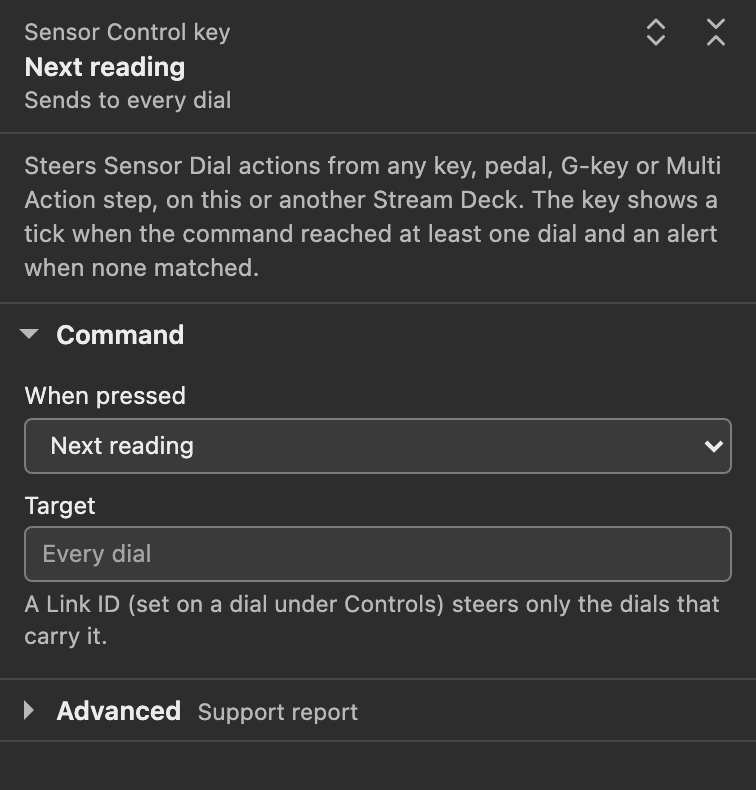

# Dial controls and presets

Choose what turning, pressing and touching a Sensor Dial does. Open its **Controls** section for **Gestures**, **Touch zones**, **Ignore turns**, **Auto cycle**, **A stats reset clears** and **Link ID**. Rotation groups are under **Reading**. Thresholds and **Auto cycle jumps to a critical reading** are under **Alerts**.

Dial gestures have not yet been run on a physical Stream Deck +. Everything on this page is what the code implements and its tests check, including recorded gesture traces replayed in software. See [Hardware compatibility](hardware.html).

## Control presets

| Preset | Turn | Pressed turn | Push | Touch tap | Long touch |
| --- | --- | --- | --- | --- | --- |
| **Legacy** (default) | Cycle readings | Cycle readings | Reset session stats, the moment the dial goes down | Cycle stat mode | Back to current value |
| **Elite** | Cycle readings | Switch sensor or [rotation group](#rotation-groups) | Short: pause or resume the auto cycle. Long (held half a second or more): reset session stats | Cycle stat mode, or [touch zones](#touch-zones) | Back to current value |
| **Custom** | Your pick | Your pick | Your pick, short and long separately | Your pick, or touch zones | Your pick |

New dials use **Legacy** until you choose another preset. A dial with no saved preset, or with a value this version does not know, also runs Legacy. Moving to another reading clears a custom title by default; set **Title when the dial moves on** to **Stays for this dial** to keep a fixed title.

Legacy details:

- The push acts the moment the dial goes down, with no timing, so Legacy has no long push. A pressed turn on Legacy therefore resets the session stats when you press, then steps readings as you turn.
- Touch zones do not apply: the whole strip is one tap.

Elite details:

- **Pressed turn** jumps between sensor groups (CPU to GPU to Memory and so on) while a plain turn steps through readings. With a [rotation set](sensor-dial.html#rotation-set-ignore-turns-and-auto-cycle), a pressed turn jumps between the sensor groups represented in your set. With [rotation groups](#rotation-groups), it jumps between your groups instead.
- A push is classified when you let go: under half a second is a short push, half a second or more a long push.
- A press that saw any rotation runs nothing when you let go. One physical interaction is one command.

The Stream Deck app's own gesture hints for the dial follow the preset you picked. Legacy shows the plugin's standard hints: *Cycle readings (set or sensor)*, *Reset session min/max*, *Cycle stat mode* and *Back to current value*. Elite shows, for example, *Cycle readings · pressed: sensor* (*group* once the dial has rotation groups) and *Pause/resume · hold: reset stats*. With touch zones the touch hint reads *Left/right: previous/next*, plus *center: stat mode* with three zones.

Under **Gestures** the settings panel lists what each gesture does on this dial now, from the same control map the dial runs. It also shows what other settings change: with **Ignore turns** on, turns read *ignored (Ignore turns is on)*; with two touch zones, touch reads *the sides switch readings; a tap does not fire*; a pause gesture notes *(auto cycle is off)* while no auto cycle is set; and a reset that reaches further than this reading names its reach. **How the presets work** at the end of the section spells out Legacy and Elite.

Folded, the **Controls** title line says the same in one line, for example *Elite: turn cycles readings · pressed turn switches sensor · push pauses or resumes the auto cycle (auto cycle is off) · tap cycles the stat*. A reset that reaches the whole rotation set or every dial is always named there, on whichever push does it, for example *long push resets session stats (every dial, everywhere)*.

### Custom

With **Custom** selected, one select per gesture appears. **Touch zones** stays below them, as on Elite.

*Settings-panel capture of the staged 1.0.1.0 panel on a simulated host with sample readings and **Accent colors** set to **Theme accent everywhere**. It is not the Stream Deck app's own window.*

| Gesture | Choices | Unset |
| --- | --- | --- |
| **Turn** | Cycle readings, Switch sensor or group, Cycle stat mode, Do nothing | Cycle readings |
| **Pressed turn** | Cycle readings, Switch sensor or group, Cycle stat mode, Do nothing | Cycle readings |
| **Short push** | Reset session stats, Pause/resume auto cycle, Pin/unpin this reading, Cycle stat mode, Back to current value, Do nothing | Reset session stats |
| **Long push** | Reset session stats, Pause/resume auto cycle, Pin/unpin this reading, Cycle stat mode, Back to current value, Do nothing | Reset session stats |
| **Touch tap** | Cycle stat mode, Back to current value, Pause/resume auto cycle, Pin/unpin this reading, Reset session stats, Do nothing | Cycle stat mode |
| **Long touch** | Back to current value, Cycle stat mode, Pause/resume auto cycle, Pin/unpin this reading, Reset session stats, Do nothing | Back to current value |

On Custom, pushes are classified on release, like Elite. Switching from Elite to Custom copies Elite's map into every gesture you have not set yourself, so "Elite with one gesture changed" is a single change. A dial that goes straight from Legacy to Custom keeps the Legacy commands for every gesture you leave unset. On Custom the gesture list under **Gestures** shows only the gestures another setting changes, because the selects already name the rest.

## Rotation groups

Optional, and nothing changes until you build them. Split the rotation set into named groups: a plain turn stays inside the active group, and a pressed turn on Elite (or any turn set to **Switch sensor or group** on Custom) jumps to the next group. The dial shows the landing group's name on its stats line for a moment.

Build them in the dial's settings panel, under **Reading**:

- **Split into groups** under the rotation list turns your current set into group 1 and adds an empty group 2, where new ticks then land.
- The radio in front of a group (*New ticks land in this group*) marks where ticks land. Tick readings in the search above the lists and they join that group; the search's label then names it, for example **Readings for group 2**. A freshly opened panel marks the group that holds the reading on the dial.
- **Earlier** and **Later** at a group's edge move the selected reading into the neighboring group. Option with Left or Right Arrow does the same from the list, Option+Home or Option+End moves it to either end of its group, and Delete takes it out of the set.
- Each group has an optional name, such as *CPU*, *GPU* or *Cooling*. An unnamed group shows on the dial as *group 2* and so on.
- **Add group** appends another group and marks it for new ticks. The **×** on a group removes it, and its readings leave the rotation. **Merge back into one set** flattens everything into a plain rotation set again.
- A line under the lists says what this dial's gestures do with the groups. When no gesture can switch groups (Legacy, or Custom without **Switch sensor or group**), it says turns run through all groups as one list, in group order, with a **Change gestures** link.

Removing a group that holds readings, and a merge that would drop a group name or fold two or more groups of readings into one, ask for a second press. The first press arms the button, which then says what goes, for example **Remove GPU and its 2 readings?** or **Merge and drop the group names?**. A quick double click only arms it. An empty group goes at once.

How groups behave:

- Groups take effect once two of them hold readings; until then rotation runs as one flat list. A reading belongs to the first group that holds it.
- The active group is wherever the reading on the dial lives. A group jump moves it, and so do a Sensor Control key and an alert interrupt. On a preset that can switch groups, turn after any of those and you step inside the group you landed in. A group whose readings are all missing is skipped by the jump.
- On those presets, the auto cycle steps inside the active group and the overviews list it. With **Auto cycle jumps to a critical reading** ticked, the cycle still watches every group: a critical reading anywhere in the set pulls the cycle to it.
- A plain turn stays inside a group only when the dial has a gesture that can switch groups. Legacy has none, so on Legacy a plain turn, the auto cycle and the overviews treat all groups as one list, in group order. A Sensor Control group jump still lands in the next group, but turns then keep stepping through that one list, past the group's last reading into the following group. On Custom, assign **Switch sensor or group** to a turn and the boundaries engage; assign it nowhere and the dial keeps one flat list, so no group can become unreachable.
- The [Sensor Control key](#the-sensor-control-key-action)'s **Next sensor or group** and **Previous sensor or group** honor your groups on every preset.
- A single group behaves like a plain rotation set. **A stats reset clears** set to **The whole rotation set** means every group.
- The flat rotation set is stored alongside the groups and kept equal to all grouped readings.

## Touch zones

Off by default, and only on Elite and Custom: the **Touch zones** select appears for those presets, and Legacy always treats the strip as one tap.

| Touch zones | What a tap does |
| --- | --- |
| **Off (the whole strip is one tap)** | The tap command, anywhere on the dial's segment |
| **Two: left and right switch readings** | Left half: previous reading. Right half: next reading |
| **Three: left and right switch, center taps** | Left third: previous reading. Center third: the tap command. Right third: next reading |

The tap command is **Touch tap** on Custom and stat cycling on Elite. With two zones it never fires. Zone edges sit at exact halves or thirds of the dial's 200 pixel wide touch segment; a tap exactly on a boundary counts as the zone to its right. A long touch runs its own command wherever you touch. Zone steps still work with **Ignore turns** on; a pinned dial does not move.

## Pause, pin, and reset reach

- **Pause/resume auto cycle** stops the auto cycle until you resume it. Resuming waits one full interval before the next step. While an auto cycle is set, the dial shows `cycle paused` where it normally says `session`.
- **Pin/unpin this reading** locks the selection: turns, touch-zone steps, the auto cycle and Sensor Control selection commands cannot move the dial off its reading until you unpin. Stat cycling, resets and pause still work from a push, a touch or a Sensor Control key. A turn does nothing while the dial is pinned or **Ignore turns** is on, even a turn set to **Cycle stat mode** on Custom. The dial shows `pinned` where it normally says `session`.
- **A stats reset clears** chooses what a reset clears: **This reading only** (default), **The whole rotation set**, or **Every dial, everywhere (use with care)**. *Every dial, everywhere* includes dials parked on other pages and profiles. No default gesture uses it; you have to pick it on purpose. After a reset the dial says `stats reset`, `set stats reset` or `all dials reset` for a moment.

Pause and pin survive page switches and profile changes for up to 30 minutes off screen; the plugin keeps the state of the 64 most recently hidden dials, and past either limit a returning dial starts fresh. They are kept in memory only, so they reset when the plugin restarts, for example when the Stream Deck app restarts.

## Session stats are per reading

Each reading keeps its own local session min, max and average, and ordinary rotation keeps that session. The reading on the dial, rotation-set members and the readings in an overview's list collect while sensors are read; hidden dials keep collecting within the limits above while a Sensor Reading key, another Sensor Dial or a detail tile is visible; a Sensor Control key does not keep sensors being read. Repeated displays of one observation do not count again, and averages are sample-weighted. Missing or non-finite readings, unit or type changes and any period without sensor data end the affected sessions, and the first live frame after a gap says so once. These sessions are separate from the MIN, MAX and AVG on Sensor Reading keys, which no dial gesture or Sensor Control key resets. See [session statistics](sensor-dial.html#session-stats-are-the-dials-own-per-reading) for the full rules and [how a dial's statistics can differ from a key's](sensor-dial.html#how-a-dials-statistics-can-differ-from-a-keys).

## Thresholds and mixed units

A reading is **warning** once it crosses **Warn at** and **critical** once it crosses **Critical at**, in the alert direction: at or above the value by default, at or below it with **Alert when the value drops to or below these numbers**. A key turns its whole face amber or red. A dial keeps its theme: in the one-reading view only the range bar's fill takes the alert color, and in the overviews, which have no bar, the alerting row's own value takes it.

**Warn at**, **Critical at** and the manual bar range apply only to readings measured in the unit they were configured against. Type a warn value of 80 while a °C reading is on the dial, and it will never fire on a fan at 3000 RPM you rotate to; the alert and the manual bar do not apply to readings in other units. Edit a threshold or a bar end and the plugin anchors them to the unit of the reading on the dial at that moment. A threshold saved without a unit anchor applies to every reading until the next edit anchors it.

Alert-aware cycling is opt-in, with **Auto cycle jumps to a critical reading in the rotation and holds there while it stays critical** under **Alerts**. Ticked, the auto cycle never rotates away from a reading that is currently critical, and its next step goes to a critical member of your set instead of the next one in order. A manual turn still moves away. Unticked (the default), alerts do not steer the cycle; it keeps stepping in order, straight through critical readings. See [Thresholds and alerts](thresholds.html).

## The Sensor Control key action

**Sensor Control** is a key action that steers Sensor Dials from another key: a plain key, a pedal, a G-key or a Multi Action step, on this or another Stream Deck. The command carries its own target, so the key's own device does not matter. Pedals and G-keys have not been checked on hardware.

*Settings-panel capture of the staged 1.0.1.0 panel on a simulated host with sample readings and **Accent colors** set to **Theme accent everywhere**. It is not the Stream Deck app's own window.*

Pick a command under **When pressed**:

| Command | What the matching dials do |
| --- | --- |
| **Next reading** (default) / **Previous reading** | Step one reading in the rotation, as a turn would |
| **Next sensor or group** / **Previous sensor or group** | Jump to the next or previous rotation group; without groups, to the next or previous sensor group |
| **Cycle stat mode** | Current, MIN, MAX, AVG, then current again |
| **Show current value**, **Show session min**, **Show session max**, **Show session average** | Show that value directly |
| **Pause auto cycle** / **Resume auto cycle** / **Pause/resume auto cycle** | Pause, resume, or toggle |
| **Pin reading** / **Unpin reading** / **Pin/unpin reading** | Pin, unpin, or toggle |
| **Reset session stats** | Clear session statistics, as far as **A reset clears** reaches |

The panel's header restates the choice in words, for example **Reset session stats, current reading** over *Sends to dials with Link ID "cpu"*. The reset command reveals **A reset clears**: **The dial's current reading** (default), **The dial's rotation set**, or **Every dial, everywhere (use with care)**. The last one ignores the **Target** and clears session stats on all dials on all Stream Decks, including hidden ones; the header then says it sends to every dial on every Stream Deck.

Targeting is explicit. Give a dial a **Link ID** (in its **Controls** section) and put the same name in the Sensor Control key's **Target** field; the key then drives only dials with that ID, wherever they are. Spaces at either end are ignored, and the rest must match exactly. An empty **Target** drives every dial.

- The command fires when you release the key, once per press, under the settings the press started with. Changing the key's settings while it is held cancels that press.
- For a moment after the release, the key shows its icon with a small tick when the command reached at least one matching dial (a pinned dial still counts as reached), and the Stream Deck alert triangle when none matched. A command this version does not know also shows the alert triangle.
- The four selection commands (next and previous reading, next and previous sensor or group) need the target dial on screen on a connected deck. They work with **Ignore turns** on, but not on a pinned dial or one whose saved reading is missing.
- The stat, pause, pin and reset commands also reach a dial parked off screen inside the same 30-minute window that keeps its pause and pin. The tick means the command matched a dial, not that anything changed on screen.
- Pause and pin have one-way commands, so repeating **Pause auto cycle** in a Multi Action does not toggle the state back.

The panel's **Advanced** section holds **Copy support report**. A Sensor Control key changes only the plugin's display and local session state; it does not control hardware or fans.

## Page swipe

Swiping sideways on the touch strip switches Stream Deck pages. The Stream Deck app handles that gesture; the plugin only keeps state across it. The reading on the dial and its labels are saved settings. Pause and pin are kept off screen within the hidden-dial limits above. Session statistics also keep collecting while a Sensor Reading key, another Sensor Dial or a detail tile stays visible; with none of those visible for 2 seconds (Sensor Control keys do not count), sensor reading stops and session statistics start again when the dial returns. A swipe that shows one of them again within those 2 seconds keeps every session. Page swipe has not been checked on a physical Stream Deck + yet; see [Page swipe and page changes](hardware.html#page-swipe-and-page-changes).

If a gesture does nothing, see [Dial gestures do nothing](troubleshooting.html#dial-gestures-do-nothing); the dial's own screens are on [Status screens](status-screens.html).

## Stored settings

These rules decide how a dial reads what is stored in its settings, whoever wrote them.

- A dial without a `controlPreset` value, or with a value this version does not know, runs Legacy.
- On Custom, a gesture with no valid command uses its Legacy command.
- **Touch zones** other than the exact two- or three-zone values mean off.
- Rotation groups are optional. Fewer than two groups that hold readings means no groups, and the flat rotation set drives the dial. The panel keeps the flat set equal to all grouped readings.
- The threshold unit anchor (`alertUnit`) is written by the plugin when you edit a threshold or bar end, from the reading on screen at that moment. Until then a threshold applies to every reading.
- The dial's **View** (`dialView`) switches face only on its exact markers, `overview` and `tworow`. Anything else draws the one-reading face.
- Per-reading names (`rotationNames`) are written only by **Rename**. An entry that is empty, blank or not text is ignored.
- **Row labels** (`overviewLabels`) shortens shared words unless it is exactly `full`. **Context line** moves below the rows only on exactly `bottom`; **Separators** hide only on exactly `off`.
- An **Auto cycle** value that is a positive whole number of milliseconds runs at that interval, even one the menu does not offer; the panel then shows it as, for example, *Every 90 s (not in this list, kept)*. Any other value means off.
- Malformed or unexpected values in any field fall back to the defaults instead of failing, so a damaged settings document still renders.
- The settings panel keeps what it does not understand. Opening a panel writes nothing. An edit writes only the settings that control owns: choosing Custom after Elite also fills the gestures you have not set, editing a threshold or bar end also stores its unit anchor, a rotation edit also updates the flat rotation set beside the groups, and **Make shared** writes the shared theme and sets this dial back to **Default**. A stored choice this version does not offer shows as *Stored value "..." (not in this list, kept)* until you pick another.

## Where to go next

- [Sensor Dial](sensor-dial.html): the dial's views, reading colors, session statistics and every setting.
- [Thresholds and alerts](thresholds.html) for warn and critical levels.
- [Hardware compatibility](hardware.html) for what has been checked on which decks.
