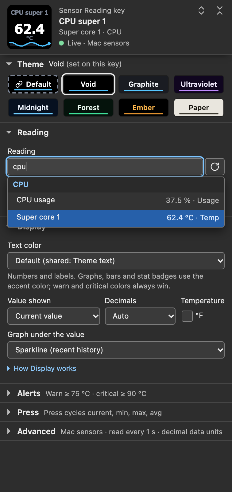

# Getting started

Put one live reading on a key, then customize it.

**You need:** macOS 13.5 or later, the Stream Deck app 7.1 or later (it supplies the Node 24 runtime), and Tahoma Bold, which ships with macOS.

## 1. Install the plugin

In Finder, double-click `com.lawrensen.mac.streamDeckPlugin` and choose **Install** when the Stream Deck app asks. The actions list gains a **Mac Sensors** category. Version 1.0.1.0 is published as a GitHub release that requires repository access; Mac Sensors is not on the Elgato Marketplace yet. [Installation](installation.html#install-the-plugin) covers getting, checking, updating and removing the package.

## 2. Confirm Tahoma Bold

Open Font Book and search for Tahoma. Tahoma Bold should be listed and turned on.

Without it, every Sensor Reading key, Sensor Dial and detail tile shows **Tahoma needed** and **Open Font Book**, and no readings appear. Install Tahoma Bold in Font Book, then choose **Check again** in the key's settings. [The Tahoma Bold prerequisite](installation.html#tahoma-bold-prerequisite) explains how the plugin checks for it.

## 3. Add Sensor Reading

In Stream Deck, drag **Mac Sensors → Sensor Reading** onto an empty key. Select the key to open its settings.

Until the first read completes, the key shows **Reading sensors**. Then it shows **Pick a sensor** and **in settings**, and the settings header says **No reading selected** and **Mac sensors ready**.

**Sensor Dial** works the same way on a dial of a Stream Deck + or + XL. The Virtual Stream Deck has no dials.

## 4. Select a reading

Click **Reading**, type part of a reading or group name such as `cpu super` or `fan`, and choose a result. The list groups readings under CPU, GPU, Memory, Storage, Network, Battery, Fans and System, as far as this Mac reports them.

Arrow keys browse, Return picks, and Tab or a click elsewhere closes the list without changing anything. The button beside the box, **Reload the sensor list**, asks the plugin for the list again. Opening the panel saves nothing.

*Settings-panel capture of the staged 1.0.1.0 panel on a simulated host with sample readings and **Accent colors** set to **Theme accent everywhere**. It is not the Stream Deck app's own window.*

## 5. Confirm a value

The key shows a number and unit, and the settings header shows **Live · Mac sensors**. Readings update once per **Read every** interval, set under **Advanced**, **Connection**: 1 second by default, from 250 ms to 5 seconds. CPU usage and transfer rates need two reads, so they appear about a quarter second after reading starts ([When reading starts and stops](data-sources.html#when-reading-starts-and-stops)).

*Settings-panel capture of the staged 1.0.1.0 panel in a simulated host with sample data, with **Accent colors** set to **Theme accent everywhere**, so the header face's sparkline uses the theme accent. It is not the Stream Deck app's own window.*

A press cycles current, min, max and avg. Mac Sensors keeps min, max and avg for each reading from its reads since the plugin last started reading sensors, and they start over after a gap in that reading ([Value shown](sensor-reading.html#value-shown-stat-mode)). Dials keep their own local session statistics.

If you see **Tahoma needed**, **Reading sensors**, **No sensor data**, **Sensor missing** or **Bridge failed**, find the exact message in [Status screens](status-screens.html) or [Troubleshooting](troubleshooting.html).

## Where to go next

- [Sensor Reading](sensor-reading.html): layouts, graphs, labels and key presses.
- [Sensor Dial](sensor-dial.html): readings on the touch strip, rotation and local session statistics.
- [Sensor details](sensor-details.html): a page of readings behind one key, with a Back tile.
- [Themes and colors](themes.html): one look for a key or the whole deck.
- [Thresholds and alerts](thresholds.html): warning and critical colors.
- [Troubleshooting](troubleshooting.html): find a status message and its next step.
