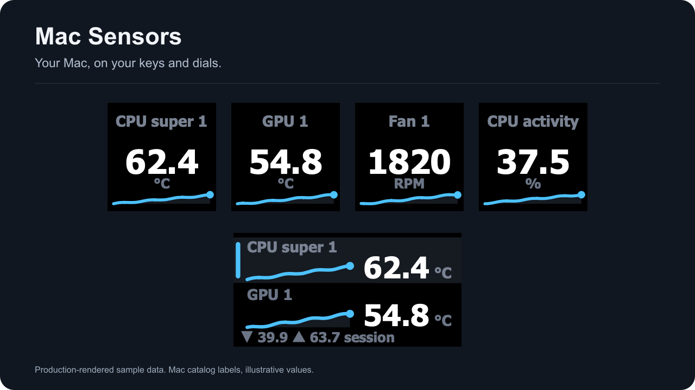

# Your Mac, on your keys and dials

Mac Sensors puts read-only hardware and system readings on Stream Deck. Choose a reading, give it the space it needs, and keep its current value in view.

*Production-rendered sample data using labels from a measured Mac catalog.*

Use one key for a large number, two to four readings together, or a dial for a reading set with local session statistics. Open sensor details when one key needs more room. Themes, thresholds and sparklines share the same drawing rules across layouts.

Start with [installation and requirements](installation.html), then [pick your first reading](getting-started.html). [Hardware compatibility](hardware.html) separates measured results from unexecuted physical checks.

The plugin reads. It does not write sensor registers, control fans, install a privileged helper, or send telemetry.
