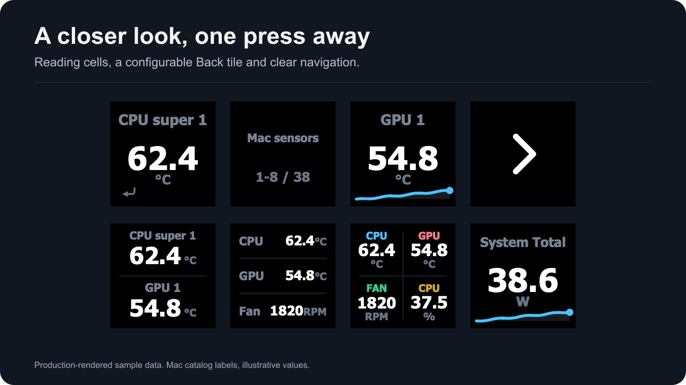

# Sensor details

Set a reading key's **Press** behavior to open sensor details. The plugin switches to a managed profile with room for the reading's group or a custom list.

*Production-rendered sample data showing detail cells and a Back tile.*

The Back tile is a real configurable reading key. You can choose its reading, layout, label and look. Pressing it always returns to the previous profile. A second Back tile mirrors the opener's position by default where the layout supports it.

A custom list can mix single, dual, triple and quad tiles. Grouping is positional: readings flow through the tile sizes in list order. Renames and colors travel with their reading when moved.

Managed profiles use a current revision for each supported grid. Development links do not automatically install those bundled profiles. If a detail switch does nothing in a dev setup, install the matching prepared profile first. Physical install and navigation checks are listed separately in [compatibility](hardware.html).

A missing reading does not silently bind to another sensor. Repair its selection in the panel or wait for the same identity to become available again.
