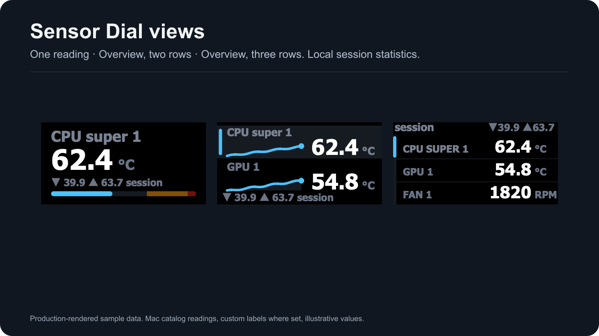
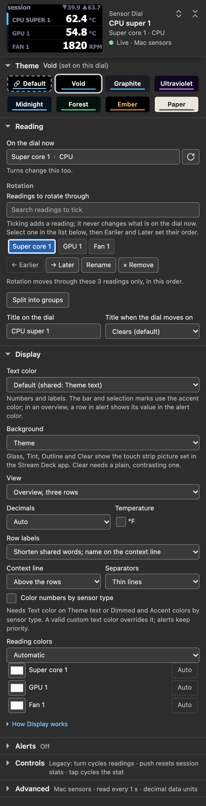
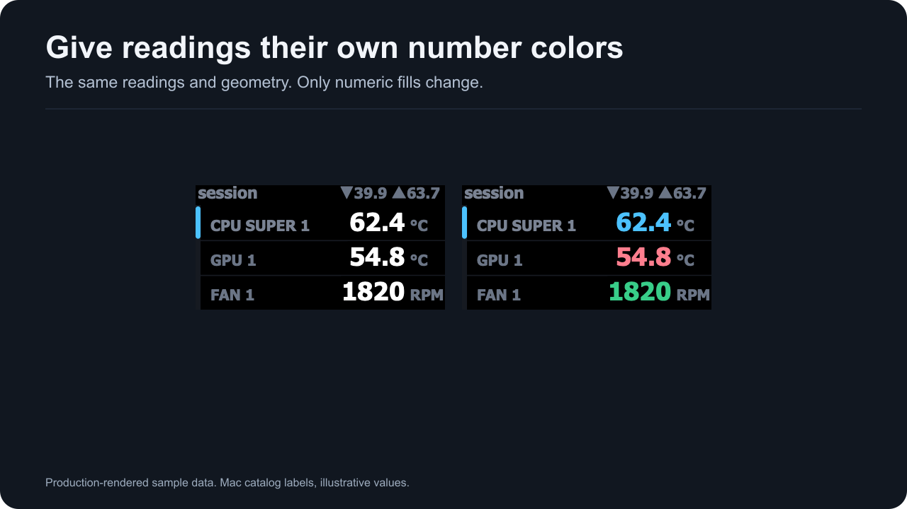
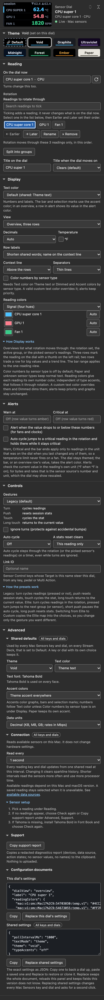

# Sensor Dial

Put **Sensor Dial** on an encoder to keep one reading or a set within reach. Its views show one reading, two rows or an overview.

*Production-rendered sample data with local session statistics.*

Rotation moves through the saved readings or groups. Missing members stay saved and are skipped until available. A label belongs to the saved reading and stays with it through a reorder.

The dial's min, max and average are local session statistics from genuine observations. They reset with the session or a reset command. A repeated display of the same observation does not count as another sample; a new acquisition with the same value does.

Individual reading colors change numeric fills while preserving labels, units, graph paths, selection and layout. Warning and critical colors still win. See [themes](themes.html) and [controls and presets](dial-controls.html).

Physical rotate, push, touch and long-touch validation requires a deck with encoders. The current software and Virtual Stream Deck evidence does not substitute for that check.

*Settings-panel capture, panel build 1.0.1.0-mac7. Simulated host with sample data.*

*Production-rendered sample data. The comparison changes number colors and preserves geometry.*

*Settings-panel capture of individual reading colors. Simulated host with sample data.*
