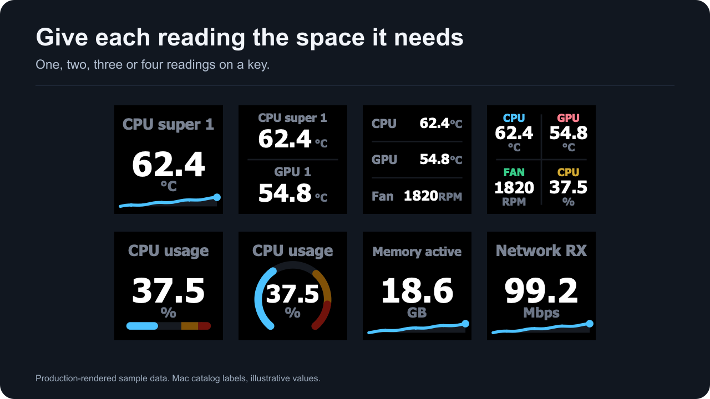
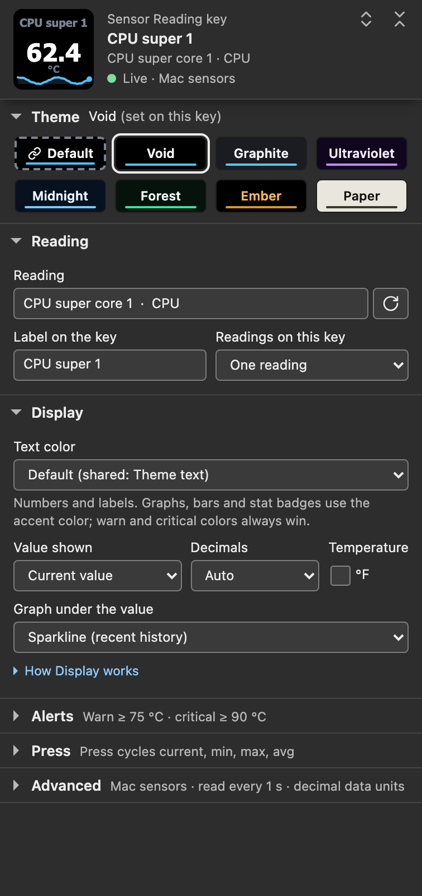
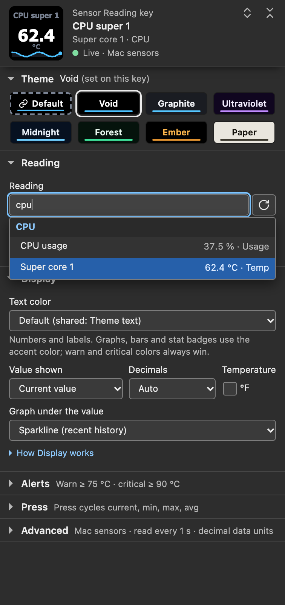
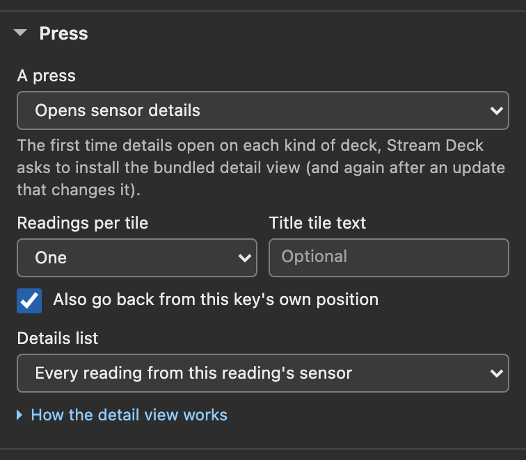
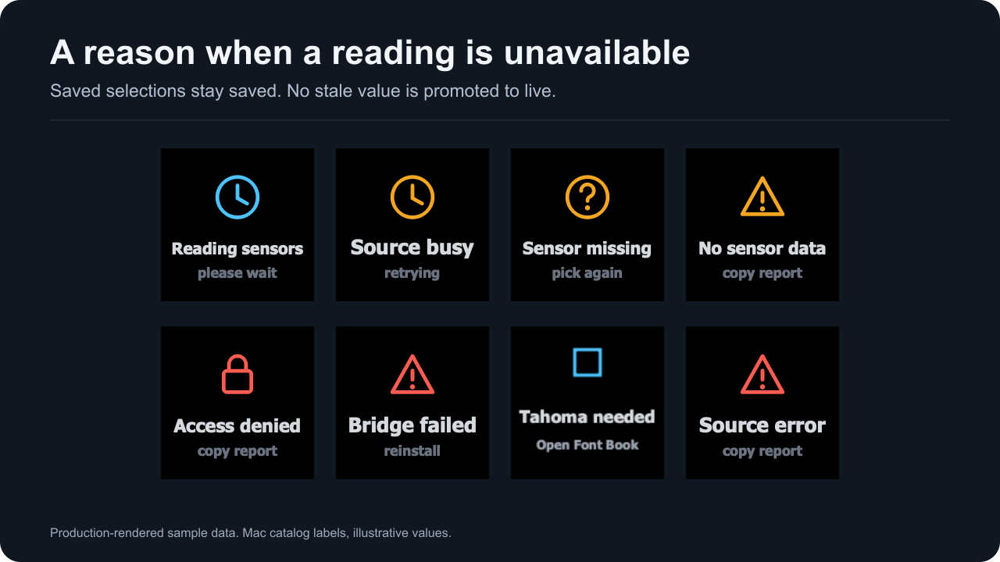

# Sensor Reading

Show one to four Mac readings on a display key. Add a graph to the one-reading layout, set warning and critical colors, or make a press open a page of related readings.

**Start:** drag **Sensor Reading** from the **Mac Sensors** category onto a key and choose a **Reading**. For the first setup, follow [Getting started](getting-started.html).

| Change | Setting or section |
| --- | --- |
| Number of readings | [Two stacked](#layout-two-readings-on-one-key), [three rows](#layout-three-readings-in-rows) or [four-cell grid](#layout-four-readings-in-a-quad-grid) |
| Graph or gauge | [Graph under the value](#graph-under-the-value-sparkline-bar-ring) |
| Look | [Theme](#theme) and [Text color](#text-color) |
| Alerts | [Warn at and Critical at](#warn-at-and-critical-at) |
| Press behavior | [Cycle the statistic or open details](#pressing-the-key) |

*Production-rendered sample data: Mac catalog readings, some with custom labels such as CPU super 1 and Network RX, and illustrative values. Rendered with **Accent colors** set to **Theme accent everywhere**, so every graph uses the Void accent instead of the default type accents.*

## Settings

The header shows the face the plugin last drew for this key, the reading's name and group, and a data state such as **Live · Mac sensors** or **Saved reading not found**. When the data or the saved selection needs attention, a message under the header names the next step and offers buttons such as **Check again**, **Sensor setup**, **Reload sensor list** or **Pick another reading**.

The theme strip, **Reading** and **Display** start open. **Alerts**, **Press** and **Advanced** start folded, and each folded title carries a one-line summary of what is in force, for example *Warn ≥ 75 °C · critical ≥ 90 °C*. The two buttons at the top right open or fold every section, and Option-click on a section title (the panel calls it Alt-click) does the same. The plugin remembers which sections you left open for each kind of panel while it runs. Folds are not saved with any key, and a restart shows the defaults again.

*Settings-panel capture of the staged 1.0.1.0 panel in a simulated host with sample data and **Accent colors** set to **Theme accent everywhere**: Void set on this key, CPU super core 1 labeled CPU super 1, a sparkline, and sample thresholds of 75 and 90.*

### Settings at a glance

The settings in panel order. Settings marked with a layout appear only for that layout. The detail view's custom tile editor is described on [Sensor details](sensor-details.html#editing-custom-tiles).

| Section | Setting | Default | Choices |
| --- | --- | --- | --- |
| Theme strip | Theme | **Default** (follows the shared theme) | Default, Void, Graphite, Ultraviolet, Midnight, Forest, Ember, Paper |
| Reading | **Reading** | none (the key shows **Pick a sensor**) | any reading this Mac reports |
| Reading | **Label on the key** | blank: the reading's own name | any text |
| Reading | **Readings on this key** | One reading | One reading; Two readings, stacked; Three readings, rows; Four readings, quad grid |
| Reading | **Reading 2**, **Label 2** | none, blank | two, three and four readings |
| Reading | **Row 2 shows** | The same stat as row 1 | Always the current value, minimum, maximum or average (two readings) |
| Reading | **Reading 3**, **Label 3** | none, blank | three and four readings |
| Reading | **Reading 4**, **Label 4** | none, blank | four readings |
| Display | **Text color** | Default (shared: Theme text) | Default, Theme text, Dimmed, Custom color |
| Display | **Custom text color**, **Dim labels, units and stats** | not set (theme text until picked), unticked | Custom color only |
| Display | **Value shown** | Current value | Current value, Minimum, Maximum, Average |
| Display | **Decimals** | Auto | Auto, 0, 1, 2, 3 |
| Display | **°F** (under **Temperature**) | unticked | ticked shows °C readings in °F |
| Display | **Graph under the value** | None | None, Sparkline (recent history), Bar (value in its range), Ring (value in its range); one reading |
| Display | **Cell colors** | Signal (four hues) | Signal, Pairs, Uniform, or one color per cell; four readings |
| Display | **Show a small label in each cell** | unticked | four readings |
| Alerts | **Warn at**, **Critical at** | blank (Off) | any number |
| Alerts | **Alert when the value drops to or below these numbers (for fans and clocks)** | unticked | ticked makes low values alert |
| Press | **A press** | Cycles current, min, max, avg | Opens sensor details; Tap cycles; hold opens details |
| Press | **Readings per tile**, **Title tile text**, **Also go back from this key's own position**, **Details list** | One; blank; ticked; Every reading from this reading's sensor | when a press opens details; see [Sensor details](sensor-details.html) |
| Press | **Add readings**, **Filter** | none; blank | A custom list, or Readings matching a filter; see [Choosing the list](sensor-details.html#choosing-the-list) |
| Advanced, Shared defaults | **Theme** | Void on a new install | the seven presets |
| Advanced, Shared defaults | **Text color** | Theme text | Theme text, Dimmed, Custom color |
| Advanced, Shared defaults | **Shared custom text color**, **Dim labels, units and stats** | not set, unticked | shared Custom color only |
| Advanced, Shared defaults | Text font | Tahoma Bold | no other font |
| Advanced, Shared defaults | **Accent colors** | By sensor type | By sensor type, Theme accent everywhere |
| Advanced, Shared defaults | **Data units** | Decimal (KB, MB, GB; rates in Mbps) | Decimal, Binary (KiB, MiB, GiB; rates in MiB/s) |
| Advanced, Connection | **Read every** | 1 second | 250 ms, 500 ms, 1 second, 2 seconds, 5 seconds |
| Advanced, Connection | **Sensor setup** | folded | three first-setup steps |
| Advanced, Support | **Copy support report** | | button |
| Advanced, Configuration documents | **This key's settings**, **Shared settings** | | Copy and Replace |

### Reading

Type part of a reading or group name in **Reading**. Every word you type must appear in the group name or the reading's label, so `airflow` lists Airflow left and Airflow right, and `gpu 3` finds GPU 3. Results are grouped under CPU, GPU, Memory, Storage, Network, Battery, Fans and System, and each row shows its value when the list loaded and, where it has one, its type, such as Temp, Fan or Power. **Reload the sensor list**, the button beside the box, fetches the list again.

*Settings-panel capture of the staged 1.0.1.0 panel on a simulated host with sample readings and **Accent colors** set to **Theme accent everywhere**. It is not the Stream Deck app's own window.*

Arrow keys move through the results and Return picks the highlighted one. Return with nothing typed and nothing highlighted closes the list and keeps the saved reading. Tab or a click elsewhere closes the list without changing anything.

The key saves the reading's identity, so a change in the list's order never retargets a key. System readings (CPU usage, memory, swap, startup volume, network and storage) have fixed identities. SMC readings (temperatures, fans, power, voltage and current) include the Mac model in their identity, so a profile moved to a different model keeps its system readings and shows **Sensor missing** for SMC readings. [Data sources](data-sources.html) explains identities.

**Sensor missing** / pick again means this Mac does not report the saved reading right now. The key keeps the reading with its label and colors and shows it again when this Mac reports it. The panel offers **Reload sensor list** and **Pick another reading**.

A reading can be absent briefly:

- CPU usage and the network and storage rates need two reads to compute. They are missing for about a quarter second when reading starts ([When reading starts and stops](data-sources.html#when-reading-starts-and-stops)), and for one read after the Mac sleeps.
- The network or storage rates skip one read when the set of network interfaces or storage devices changes.
- A failed SMC read removes that reading until a later read succeeds.

When the whole source is unavailable, the key shows a [status screen](#status-screens) instead.

### Label on the key

Custom text for the key. Leave it blank, or only spaces, to use the reading's own name from the Mac catalog. A short label draws at the largest of three sizes, a longer one steps down, and only a label too wide for the smallest size is cut with an ellipsis. Label sizes come from measured Tahoma Bold glyph widths. A MIN, MAX or AVG badge sits in its own gap under the label, so it never takes label width.

In the quad grid with small labels turned on, each label becomes a cell label of at most four characters; see [the quad grid](#layout-four-readings-in-a-quad-grid).

### Theme

Pick a theme in the strip under the header: **Default**, **Void**, **Graphite**, **Ultraviolet**, **Midnight**, **Forest**, **Ember** or **Paper**.

- A named theme applies to this key only.
- **Default** follows **Advanced → Shared defaults → Theme**, shared by every Mac Sensors key and dial.
- **Change** opens the shared theme setting. **Make shared** takes its place when this key's theme differs from the shared one: it makes that theme the shared theme and returns this key to Default.

The line above the chips names the theme and where it comes from, such as **Default (shared: Void)** or **Ember (set on this key)**. A key with no reading draws its prompt on black and shows the theme once a reading is picked. [Compare themes and colors](themes.html).

### Text color

How the key's text draws, first in **Display**:

- **Default** *(default)*: follows **Advanced → Shared defaults → Text color**. The option names that setting, for example **Default (shared: Theme text)**.
- **Theme text**: the theme's own text colors, even when the shared setting is Dimmed or Custom color.
- **Dimmed**: the theme's text moved toward the background, for a dark room. Values and units keep a calculated contrast of at least 4.5:1.
- **Custom color**: your exact color for the value. **Custom text color** appears with its hex code; until you pick a color, the key keeps theme text. **Dim labels, units and stats (the value keeps the exact color)** draws labels, units and the stat badge in the same hue closer to the background. Unticked (the default), every text element uses the exact color.

Text color changes numbers, labels and units. Sparklines, bars, rings and their tracks keep the theme or type accent. The stat badge takes the accent with Theme text, a dimmed accent with Dimmed, and your color with Custom color. Warning and critical colors replace every text choice while a key alerts. Details: [Text: Theme, Dimmed or Custom](themes.html#text-theme-dimmed-or-custom).

### Value shown (stat mode)

What the number on the key shows:

| Option | Shows |
| --- | --- |
| **Current value** *(default)* | The live reading. |
| **Minimum** | The lowest value accepted for this reading since the plugin last started reading sensors, with a **MIN** badge. |
| **Maximum** | The highest value accepted since then, with a **MAX** badge. |
| **Average** | The arithmetic mean of the values accepted since then, with an **AVG** badge. |

*Production-rendered sample data with sample session statistics, drawn with **Accent colors** set to **Theme accent everywhere**.*

macOS reports current values only, so Mac Sensors keeps these statistics itself, for every reading this Mac reports. Changing pages, opening sensor details and pressing Back keep the statistics, because reading continues for 2 seconds after the last Sensor Reading key, Sensor Dial or detail tile disappears ([When reading starts and stops](data-sources.html#when-reading-starts-and-stops)). Each accepted read adds one sample, including a read that repeats the last value, so the average counts reads and is not weighted by time. On the first read after the plugin starts reading sensors, MIN, MAX and AVG all equal the current value. The statistics follow **Decimals**, **°F** and **Data units** the same way the live value does.

Statistics are kept per reading. Every Sensor Reading key and detail tile that shows the same reading shows the same MIN, MAX and AVG. A key you add, or switch to another reading, shows that reading's statistics at once, including reads made before the change.

A reading's statistics start over:

- after a gap in that reading: a read where it is missing or withheld (invalid, out of range or duplicated), or a failed read of its source, which removes every reading from that source;
- when the reading expires, 15 seconds after its last accepted read, for example across a sleep longer than that;
- when the reading's unit or type changes;
- for CPU usage and the network and storage rates, after any sleep, because they skip one read; the rates also skip one when the set of network interfaces or storage devices changes;
- when the plugin stops reading sensors, 2 seconds after the last Sensor Reading key, Sensor Dial or detail tile disappears, which ends every reading's statistics. They are kept in memory only, so a plugin restart also starts them over.

Changing **Read every** keeps them; it clears sparklines only. There is no reset for a key's statistics.

With the default **A press**, the **How Display works** fold says: *Pressing the key cycles current, min, max and avg. Min, max and avg come from this session's reads; they start over after a gap in the reading, or when no Mac Sensors key, dial or detail tile has been shown for 2 seconds.* Sensor Control keys do not count as shown.

A Sensor Dial keeps separate statistics of its own, which can differ from a key's for the same reading; see [Session stats are the dial's own, per reading](sensor-dial.html#session-stats-are-the-dials-own-per-reading).

Alert colors and Bar and Ring fills follow the live value whatever **Value shown** says. A key showing MAX keeps its normal colors while the live value is back under **Warn at**, even when the maximum is past it.

### Layout: two readings on one key

Choose **Readings on this key → Two readings, stacked**, then pick **Reading 2** and an optional **Label 2**. Until Reading 2 is picked, the key keeps one reading and the panel says *This layout draws once another reading is picked below. Until then the key shows one reading.*

**Row 2 shows** sets the second row's statistic:

- **The same stat as row 1** *(default)*: a press cycles both rows together, with one badge in the divider.
- **Always the current value**, **Always the minimum**, **Always the maximum** or **Always the average**: row 2 stays put while a press cycles row 1. Each row that shows a statistic gets its own badge on its label line; matching statistics share the divider badge.

Each row shows its own reading's statistics. For a minimum and maximum pair, set **Value shown** to **Minimum** and **Row 2 shows** to **Always the maximum**. Useful pairs are CPU super core 1 above GPU 1, or Network receive above Network send.

**Rules for every multi-reading layout:**

- **Warn at** and **Critical at** watch the first reading only and recolor the whole key. Put the reading you need alerts on first, or give it its own key. The Alerts help then adds *Only reading 1 is checked; it recolors the whole key.* and the folded summary ends in *first reading*.
- **Decimals** and **°F** apply to every reading. The type accent follows the first reading.
- **Graph under the value** is for one reading only. It stays saved while hidden.
- A reading this Mac does not report shows a dash while the others continue. In two and three rows its row keeps its custom label, or reads *Sensor missing*. If every picked reading is missing, the key shows **Sensor missing** / pick again.
- Changing layouts keeps readings, labels and colors. Reading 2 serves all three multi-reading layouts, and Reading 3 serves both three rows and the quad grid. Switching to One reading draws the single face again.

### Layout: three readings in rows

Choose **Readings on this key → Three readings, rows**, then set **Reading 2** and **Reading 3**, with optional **Label 2** and **Label 3**. Each row has a left-aligned label and a right-aligned value with its unit. The layout needs the first reading and at least one more; an unpicked row stays empty.

All rows show the same statistic and a press cycles them together; the badge appears once, on the first separator. Values share one size, and a long label shortens so its number stays whole. The panel says so: *A long name shortens so its number stays whole. Every row shows the same stat.* The [multi-reading rules](#layout-two-readings-on-one-key) apply, and this layout has no graph strip.

### Layout: four readings in a quad grid

Choose **Readings on this key → Four readings, quad grid**. The first reading is top left, **Reading 2** top right, **Reading 3** bottom left and **Reading 4** bottom right. It needs the first reading and at least one more; unpicked cells stay empty.

**Cell colors** in Display tells the cells apart:

- **Signal (four hues)** *(default)*: blue `#4CC2FF`, rose `#FF7E8E`, green `#38CD89` and gold `#D4AB33`.
- **Pairs (top row, bottom row)**: blue on top, rose below.
- **Uniform (accent blue)**: blue in every cell.
- The four color wells set one cell each. The preset reads **Custom** when the four colors match no preset.

**Show a small label in each cell (values then use the text color)** puts a short label in the cell color above each value, and values take the key's **Text color**. With **Custom color**, the labels take the custom color's secondary shade instead of the cell color. Unticked *(default)*, values take the cell colors.

With small labels on, cell labels come from **Label on the key** and **Label 2**, **Label 3** and **Label 4**, or else from the first word of the reading's name. They are upper-cased and cut at four characters, and the label fields say *4 chars max* in this layout. Startup volume available becomes STAR, so give it a label such as FREE. Values compact to four characters at most: decimals drop first, then large numbers shorten, such as 48700 to 49k.

A press cycles every cell through the same statistic, with one badge at the center. The [multi-reading rules](#layout-two-readings-on-one-key) apply, and the layout has no graph strip.

The automatic cell colors are lifted for contrast against the background when needed. Colors you pick draw exactly with Theme text and are only blended toward the background with Dimmed; they are never lifted for contrast, so check them on your deck. A **Custom color** text setting replaces the cell colors, and so does a warning or critical alert. [Themes and colors](themes.html#text-theme-dimmed-or-custom) explains color precedence.

### Decimals

- **Auto** *(default)*: precision follows the size of the number. Below 10 shows two decimals, from 10 one, from 100 none, and from 10,000 a k, M, G or T suffix (48700 reads 48.7k).
- **0**, **1**, **2** or **3**: that many decimal places.

Byte quantities and transfer rates rescale through their own units instead; see [Data units](#data-units). Auto shows zero as 0.00, so a stopped fan reads 0.00 RPM. Choose **0** for fan keys.

### Temperature unit

The **°F** box under **Temperature** converts °C readings to Fahrenheit for display. Every Mac temperature arrives in °C; other units are unchanged. Thresholds compare against the displayed unit, so a key switched to °F needs its thresholds in °F (80 °C is 176 °F). A sparkline keeps its line through the switch.

### Graph under the value: sparkline, bar, ring

**Graph under the value** in Display adds one strip under the value. It shows only on the one-reading layout:

- **None** *(default)*: the value alone.
- **Sparkline (recent history)**: a line of the reading's recent samples along the bottom of the key, in the accent color over a filled track, ending in a dot at the newest sample.
- **Bar (value in its range)**: a horizontal gauge showing where the live value sits in its range.
- **Ring (value in its range)**: the same gauge as an arc around the value, opening downward.

Bar and Ring find their range automatically, and there are no bounds to type:

- **Percentages** run 0 to 100. On Mac that is CPU usage.
- Every other reading spans the values seen: the reading's MIN and MAX since the plugin last started reading sensors (see [Value shown](#value-shown-stat-mode)), the live value, and the recent samples the plugin holds for it, up to 36. The range therefore keeps its width when a **Read every** change clears the samples. While MIN and MAX are still equal, the range has no width, and the fill sits at the halfway point unless a threshold widens it.
- **Warn at** and **Critical at** draw amber and red zones toward the alarmed end: the high end normally, the low end when the direction box is ticked. The range widens to keep a zone visible, with a small margin when a threshold sits at or past the edge.

The panel's range sentence also mentions Yes/No readings, which run 0 to 1; the current Mac catalog has none.

Zones draw as muted shades: the alert color blended 45 percent toward the key background. They mark positions; the fill on top shows the live value in the accent color. While the key alerts, the whole key takes the alert palette, and the fill and zones follow it. The fill follows the live value even while the text shows MIN, MAX or AVG.

Sparkline notes:

- It holds the last **36 samples**, one for each new measurement of the reading. At **Read every** 1 second that covers about the last 36 seconds.
- The line scales to its own lowest and highest sample, so its shape shows how the reading changed recently. Identical samples draw a level line across the middle. Two samples are needed before a line draws.
- Samples keep collecting for a reading a key has shown while any Sensor Reading key, Sensor Dial or detail tile is visible, so a key on another page resumes its line when you return.
- When no reading key, dial or detail tile has been visible for 2 seconds, reading stops and every sparkline is cleared. A page change, opening sensor details or pressing Back inside those 2 seconds keeps every line.
- A missing or failed reading, a change in the reading's type or unit, a status screen, a **Read every** change and a plugin restart clear the history.
- Switching between °C and °F keeps the line unchanged.

### Warn at and Critical at

In **Alerts**. When the live value reaches **Warn at**, the whole key turns amber with dark text; at **Critical at**, red with white text. The two alert palettes are the same on every theme. Leave a field blank to turn it off; an empty field shows *Off*.

Thresholds use the displayed temperature unit. Byte and rate thresholds use the reading's own unit, bytes or bytes per second, before [Data units](#data-units) rescales it. A comma works as a decimal point (`70,5` is 70.5). Text that is not a number is kept as typed, ignored, and flagged under the field: *Not a number. Alerts ignore this field until it is one.*

The folded Alerts title reads back the comparison in force, for example *Warn ≥ 80 °C · critical ≥ 90 °C*. It ends in *first reading* on a multi-reading key, and in *warning now* or *critical now* while the key alerts.

See [Thresholds and alerts](thresholds.html) for the full behavior and worked examples with Mac readings.

### Direction

**Alert when the value drops to or below these numbers (for fans and clocks)** makes lower worse: the alert fires at or below each number. Use it for fan speed or free space on the startup volume. Unticked *(default)*, higher is worse, for temperatures, power and CPU usage.

## Pressing the key

By default a press cycles **Value shown**: current, MIN, MAX, AVG, then current again. The badge under the label follows, and the choice is saved to the key, the same as changing **Value shown**. MIN, MAX and AVG are the reading's statistics since the plugin last started reading sensors, as [Value shown](#value-shown-stat-mode) describes; a press changes only which one the key shows and resets nothing. With the default press, a key with no reading ignores it. Alert colors keep following the live value throughout.

On a two-reading key with **Row 2 shows** at its default, a press cycles both rows together. A row pinned to a fixed statistic stays put while the first row cycles. On the three-row and quad layouts a press cycles every reading together.

### A press can open details

*Settings-panel capture of the staged 1.0.1.0 panel on a simulated host with sample readings and **Accent colors** set to **Theme accent everywhere**. It is not the Stream Deck app's own window.*

**Press → A press** sets what a press does:

- **Cycles current, min, max, avg** *(default)*: the cycle above.
- **Opens sensor details**: on key down, the deck switches to a bundled detail view listing every reading in this reading's group, a custom list, or the readings matching a filter.
- **Tap cycles; hold opens details**: a press released within half a second cycles the statistic; holding for half a second opens details once.

The first time details open on each kind of deck, Stream Deck asks to install the bundled detail view, and again after an update that changes it. On a deck with no fitting detail view, the panel says *Sensor details are not available on this deck* and a press shows the Stream Deck alert triangle instead. [Sensor details](sensor-details.html) covers what the view shows, its settings and which decks it supports.

The detail view's Back tile is this same Sensor Reading action with its press fixed to returning to the previous profile. Its panel says so under the header, and its Press section holds that note in place of the press choices. Everything else on this page, from the reading and layouts to the theme and thresholds, applies to it. See [Configuring the Back tile](sensor-details.html#configuring-the-back-tile).

## Status screens

A two-line status replaces the value when the key cannot show a reading. The saved reading and settings stay unchanged, and the screen clears on the first read that produces a current reading.

*Production-rendered status screens with sample scenarios. Status screens use fixed colors, so the theme does not change them.*

| Key shows | Meaning | What to do |
| --- | --- | --- |
| **Pick a sensor** / in settings | The key works, but no reading is selected yet. | Type in the **Reading** box and choose a reading. |
| **Reading sensors** / please wait | No reading has arrived since reading started: the first read is still out. | Wait for the first read. |
| **Sensor missing** / pick again | A reading is selected, but this Mac does not report it right now. | Choose **Reload sensor list** or **Pick another reading**; see [Reading](#reading). |
| **Source busy** / retrying | 15 seconds after reading started, the first read has still not finished. | Choose **Check again**. |
| **No sensor data** / copy report | Both sources answered, but no reading is current. | Choose **Check again**. If it stays, choose **Copy support report** under **Advanced → Support**. |
| **Tahoma needed** / Open Font Book | The plugin could not find the font Tahoma Bold. | Install Tahoma Bold in Font Book, then choose **Check again**. |
| **Bridge failed** / reinstall | The native reader for the Node runtime's architecture could not be used. | Quit and reopen Stream Deck. If it persists, see [Keys show Bridge failed](troubleshooting.html#keys-show-bridge-failed). |
| **Source error** / copy report | A read failed in a way that has no more specific screen. | Choose **Check again**. If it stays, choose **Copy support report** under **Advanced → Support**. |
| **Needs macOS** / check requirements | The plugin is not running on macOS with an arm64 or x86_64 Node runtime. | See [Installation and requirements](installation.html#system-requirements). |

Key status screens draw on black in every theme. [Status screens](status-screens.html) and [Troubleshooting](troubleshooting.html) give every screen, its causes and the full repair path.

## Advanced (shared by keys and dials)

**Advanced** holds four groups. **Shared defaults** and **Connection** are marked **All keys and dials**: they change every Mac Sensors key and dial on every Stream Deck. The folded title summarizes them, for example *Mac sensors · read every 1 s · decimal data units*.

- **Shared defaults**: **Theme**, **Text color** (with **Shared custom text color** and **Dim labels, units and stats**), Text font, **Accent colors** and **Data units**. They apply to every key and dial left on Default; a key or dial with its own choice keeps it. See [Themes and colors](themes.html).
- **Connection**: **Read every** sets how often the plugin reads the sensors on this Mac: 250 ms, 500 ms, 1 second *(default)*, 2 seconds or 5 seconds. Every reading key and dial updates from that one shared read. Changing it clears sparkline history, and shorter intervals read the sensors more often and use more processor time. [Data sources](data-sources.html) explains reads and timing. **Sensor setup** folds out three first-setup steps.
- **Support**: **Copy support report** copies a redacted diagnostics report to the clipboard. Nothing is uploaded. See [Troubleshooting](troubleshooting.html).
- **Configuration documents**: copy or replace this key's settings and the shared settings.

### Configuration documents

Two JSON wells: **This key's settings**, the exact settings this key runs on, and **Shared settings**, marked **All keys and dials**. **Copy** fills an untouched well with the settings of that moment and puts the document on the clipboard; save it to a file to back a layout up. Paste a saved document and press **Replace this key's settings** to restore it or clone it onto another key. Replacing writes the whole document at once and reloads the panel, and fields this version does not know are kept. Text that is not one JSON object is refused and nothing changes.

**Replace shared settings** changes every Mac Sensors key and dial, so its first press only arms it: the button reads *Press again to replace for all keys and dials*, and a second press replaces. A double click only arms it, and leaving the button or editing the document disarms it.

In the key's document each reading identity carries the reading's name after it, so the file stays readable; an identity with no name is a reading this Mac does not report now. Replacing strips the names, and settings always store the bare identity. The wells exist on the Sensor Reading and Sensor Dial panels only.

### Data units

**Data units** sets how byte quantities and transfer rates read on every key and dial:

- **Decimal (KB, MB, GB; rates in Mbps)** *(default)*: bytes in B, KB, MB, GB and TB (steps of 1000), and rates in bits per second, bps through Tbps (byte rates times 8).
- **Binary (KiB, MiB, GiB; rates in MiB/s)**: bytes in B, KiB, MiB, GiB and TiB (steps of 1024), and rates in bytes per second, B/s through TiB/s.

Every Mac rate is a byte rate, including Storage read and Storage write, so under Decimal those read in Mbps too.

| Reading in a live read on the measured M5 Pro | Source value | Decimal | Binary |
| --- | --- | --- | --- |
| Startup volume available | 292596883456 B | 293 GB | 273 GiB |
| Memory total | 68719476736 B | 68.7 GB | 64.0 GiB |
| Network send | 2909517.6 B/s | 23.3 Mbps | 2.77 MiB/s |

This is display only. **Warn at**, **Critical at** and a dial's bar range compare against the source value in bytes or bytes per second, so switching Decimal and Binary never changes an alert.

## Where to go next

- [Thresholds and alerts](thresholds.html): units, direction and worked examples for **Warn at** and **Critical at**.
- [Themes and colors](themes.html): the seven presets, text modes and type accents.
- [Sensor details](sensor-details.html): the page a press can open.
- [Sensor Dial](sensor-dial.html): the same readings on a Stream Deck + dial.
