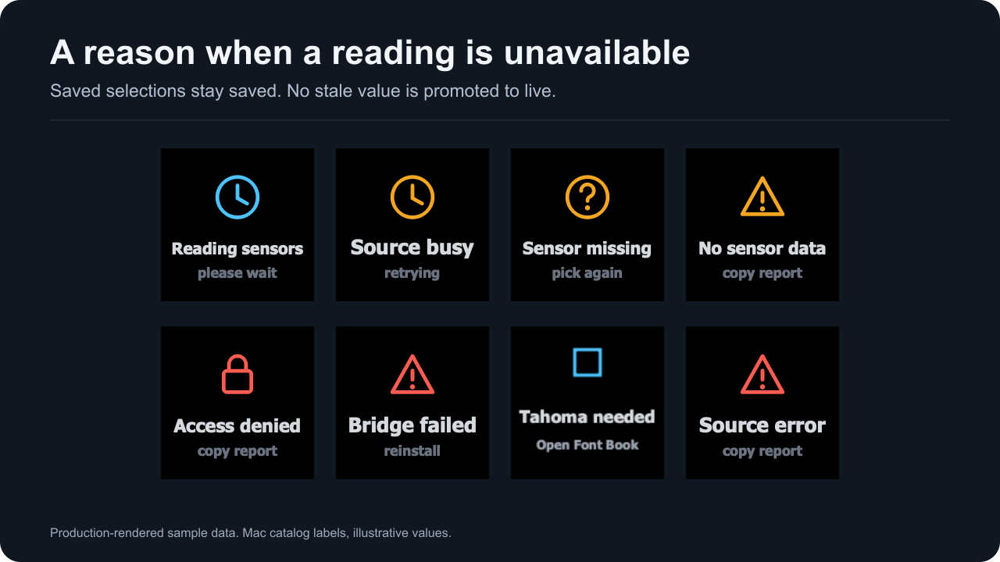

When a key or dial cannot show a current reading, it shows a two-line status screen instead. The first line names the condition; the second names the next step. [In the settings panel](#in-the-settings-panel) explains what the panel shows at the same time, and [Troubleshooting](troubleshooting.html) has the full repair path.

A status screen never changes saved settings. The selected reading, its label, colors and every other setting stay as they were. **Pick a sensor** clears when you pick a reading, and **Sensor missing** when this Mac reports the saved reading again or you pick another. **Bridge failed** and **Needs macOS** last until the plugin restarts. Every other screen clears by itself on the first read that produces a current reading.

*Production-rendered status screens with sample scenarios. Status screens use fixed colors, so the theme does not change them.*

## Key screens

| Key shows | Looks like | What it means | What to do |
| --- | --- | --- | --- |
| **Reading sensors** / please wait | Blue clock | No reading has arrived since reading started: the first read is still out. It also returns if every reading lapses or fails before the first SMC read of that session has answered. | Wait for the first read. If it has still not finished after 15 seconds, the key changes to **Source busy**. |
| **Source busy** / retrying | Amber clock | 15 seconds after reading started, the first read has still not finished: no system counter read has succeeded and at least one source has not answered. | Choose **Check again**. If it stays, choose **Copy support report** under **Advanced**, **Support** first, then quit and reopen the Stream Deck app, which restarts the plugin. |
| **No sensor data** / copy report | Amber warning triangle | Both sources answered, but no reading is current: every reading failed, was withheld or expired. It can appear briefly after the Mac wakes from a sleep longer than 15 seconds. | Choose **Check again**. If it stays, choose **Copy support report** under **Advanced**, **Support** and file an issue. |
| **Tahoma needed** / Open Font Book | Fixed image: blue square outline above the two lines | macOS did not return Tahoma Bold. Readings are hidden until it is available. The screen is stored as pixels, so it draws without the font. | Install Tahoma Bold in Font Book, or turn it on. The screen clears on the next read; **Check again** only makes that read happen at once. See [Keys show Tahoma needed](troubleshooting.html#keys-show-tahoma-needed). |
| **Bridge failed** / reinstall | Red warning triangle | The native reader for this processor could not be used. The result is kept until the plugin restarts. | Quit and reopen Stream Deck. If it persists, remove Mac Sensors and install it again. See [Removing](installation.html#removing) and [Keys show Bridge failed](troubleshooting.html#keys-show-bridge-failed). |
| **Source error** / copy report | Red warning triangle | A read failed in a way no other screen covers. Known causes: the native reader's clock returned no usable time, or both sources answered but the system counter read failed, so the font check that runs with it could not run. | Choose **Check again**. If it stays, copy a support report first, then quit and reopen the Stream Deck app, and file an issue. |
| **Needs macOS** / check requirements | Red warning triangle | The Node runtime that started the plugin is not macOS on arm64 or x86_64. With the runtime the Stream Deck app supplies, this screen is not expected. | Check [Installation and requirements](installation.html), then copy a support report. |
| **Pick a sensor** / in settings | Blue target | The key works, but no reading is selected yet. | Open the key's settings, type in the **Reading** box and choose a reading. |
| **Sensor missing** / pick again | Amber question mark | A reading is selected, but this Mac does not report it right now. | Open the key's settings. The panel says whether this Mac reports the reading. See [Keys show Sensor missing](troubleshooting.html#keys-show-sensor-missing). |

The three colors are blue `#4cc2ff` (waiting or setup), amber `#f5a623` (attention) and red `#ff5d52` (failure).

**Reading sensors**, **Source busy**, **No sensor data** and **Source error** come from the two data sources (see [Data sources](data-sources.html)). **Pick a sensor** and **Sensor missing** are about this key's selection; other readings keep working. **Bridge failed** and **Needs macOS** are about the installation and the runtime. **Tahoma needed** is about the font prerequisite.

**Sensor missing** can be temporary. A reading that failed its last read, or CPU usage and the transfer rates for about a quarter second after reading starts, also show it. On a key with two to four readings, the screen appears only when every configured reading is missing; a single missing row shows its label, or **Sensor missing**, with a placeholder dash.

Detail tiles show the same screens. The Back tile keeps its return arrow on every status screen, including the fixed **Tahoma needed** image.

One screen is detail-only. After a plugin restart while a detail page is showing, its reading tiles show **No detail** / selected with a blue target, and the Back tile shows a plain Back with a left chevron. Press Back, then open details again ([Detail view problems](troubleshooting.html#detail-view-problems)).

### Screens 1.0.1 does not report

Two more screens are defined in the plugin's status set. No read in version 1.0.1 reports either of them.

| Screen | Looks like | Panel sentence | In 1.0.1 |
| --- | --- | --- | --- |
| **Access denied** / copy report | Red lock | "macOS denied a read. Choose Copy support report under Advanced, Support." | When the SMC service cannot be opened, the SMC readings are left out, the system counters keep working, and the support report records the error under `sourceErrors`. |
| **Not updating** / check again | Amber clock | "No recent measurement is available. Choose Check again." | A reading older than 15 seconds is removed instead of being held, so no source is ever reported as not updating. |

If you see either of them, copy a support report and file an issue.

## Dial screens (Stream Deck +)

Dials show the same states in the touchscreen's title and value lines:

| Dial title | Dial value | Notes |
| --- | --- | --- |
| Reading sensors | please wait | |
| Source busy | retrying | |
| No sensor data | copy report | |
| Tahoma needed | Open Font Book | Fixed image, like the key screen |
| Bridge failed | reinstall | |
| Source error | copy report | |
| Needs macOS | check requirements | |
| Mac Sensors | rotate to pick | No reading selected yet; the bottom line says "or use the settings panel" |
| Sensor missing | waiting | The saved reading is not reported right now; the bottom line says "reselect in settings" |

While a dial shows a status screen or **Sensor missing** / **waiting**, turning it does not change its reading. A temporary dropout therefore cannot move the dial off the saved reading, and the dial recovers by itself when the reading returns. A small **pinned** or **cycle paused** label on a live dial is not a status screen; see [Dial controls and presets](dial-controls.html).

Checks of these faces and of dial gestures on a physical Stream Deck + are pending; see [Hardware compatibility](hardware.html).

## In the settings panel

The header of a Sensor Reading or Sensor Dial panel names the data state on its last line:

| Header says | When |
| --- | --- |
| Connecting to the plugin | The panel has opened and the plugin has not answered yet |
| The plugin is not responding | No answer came within 3 seconds |
| No sensor data | The key or dial shows any status screen, including **Reading sensors** and **Tahoma needed**; the message below names the cause |
| Mac sensors ready | Readings are available and no reading is selected yet |
| Saved reading not found | The selected reading is missing |
| Live · Mac sensors | The selected reading has a current value |

When there is something to fix, a message sits right under the header with the fix as a button:

| The message is about | It says | Buttons |
| --- | --- | --- |
| A status screen | That screen's panel sentence (below), then "Your reading and every setting stay saved. Display settings can still be changed; they apply when data returns." With no reading selected, the second line is "Readings appear under Reading once data returns." | **Check again**, **Sensor setup** |
| The selected reading is missing | "The key keeps the saved reading with its label and colors. This Mac does not report it right now; it shows again when this Mac reports it." (On a dial it says "The dial keeps".) | **Reload sensor list**, **Pick another reading** |
| The plugin answered with an empty reading list | "This Mac reports no readings right now." | **Sensor setup** |
| The plugin is not answering the panel | "The Mac Sensors plugin is not answering this panel. Settings you change here are still saved; restarting the Stream Deck app restarts the plugin." | None |

Panel sentences for each status screen:

| Screen | Panel sentence |
| --- | --- |
| Reading sensors | "Readings appear after the first successful sample." |
| Source busy | "The source is busy. Choose Check again to request another check." |
| No sensor data | "No readable sensors were found. Choose Copy support report under Advanced, Support." |
| Tahoma needed | "Install Tahoma Bold in Font Book, then choose Check again." |
| Bridge failed | "The native reader could not load. Reinstall Mac Sensors, then choose Copy support report if it still fails." |
| Source error | "The sensor source could not be read. Choose Copy support report under Advanced, Support." |
| Needs macOS | "This build needs a supported Mac and app version. Open Installation and requirements in the docs." |

What the buttons do:

- **Check again** and **Reload sensor list** ask the plugin for a new read and a fresh answer, while a Sensor Reading key, Sensor Dial or detail tile is visible. If the answer is the same problem, one line says so with the time and your **Read every** value, for example "Checked again at 14:02:31: no change yet. The plugin also reads sensors every 1 s on its own."
- **Sensor setup** opens the **Sensor setup** steps under **Advanced**, **Connection**: pick a reading under **Reading**; if no readings appear, choose **Check again** or **Copy support report** under **Advanced**, **Support**; if Tahoma is missing, install Tahoma Bold in Font Book and choose **Check again**.
- **Pick another reading** moves to the **Reading** search box. Nothing is saved until you choose a reading.

The reload button beside the **Reading** search box, labeled "Reload the sensor list", reloads the list from the latest read without starting a new one.

## Recovery

A status screen does not require removing the key. While a Sensor Reading key (including the Back tile), Sensor Dial or detail tile is visible, the plugin keeps reading at the **Read every** interval:

- Every read asks both sources again. A source that failed is asked again on the next read, and the other source keeps serving meanwhile. One exception: SMC readings wait for the first successful system counter read, which carries the font check. Until then keys show **Source error**, or **Source busy** if a read is still out after 15 seconds.
- If the SMC connection breaks, the next read opens it again.
- The font check runs on every system counter read, so **Tahoma needed** clears on the first read after Tahoma Bold is available. **Check again** is not required; it only makes that read happen at once.
- A read that starts while a status screen shows never waits more than 100 ms for a slow source, so readings return at most 100 ms after their own source answers.
- A page you return to after no Sensor Reading key, Sensor Dial or detail tile was visible anywhere for 2 seconds starts reading again and shows **Reading sensors** until its first read completes. A page change, opening sensor details or pressing Back inside those 2 seconds shows readings at once ([When reading starts and stops](data-sources.html#when-reading-starts-and-stops)).

**Bridge failed** and **Needs macOS** do not recover by themselves; the result is kept for the life of the plugin process. For **Bridge failed**, quit and reopen Stream Deck. **Needs macOS** means the Node runtime is not a supported macOS one, which a restart does not change; see [Installation and requirements](installation.html#system-requirements). A load failure alone does not establish whether a file is damaged, missing or blocked.

## Where to go next

- [Troubleshooting](troubleshooting.html) has the full repair path for each screen.
- [Data sources](data-sources.html) explains the two sources behind these screens, freshness and sleep.
- [FAQ and privacy](faq.html) answers common questions about readings and support reports.
