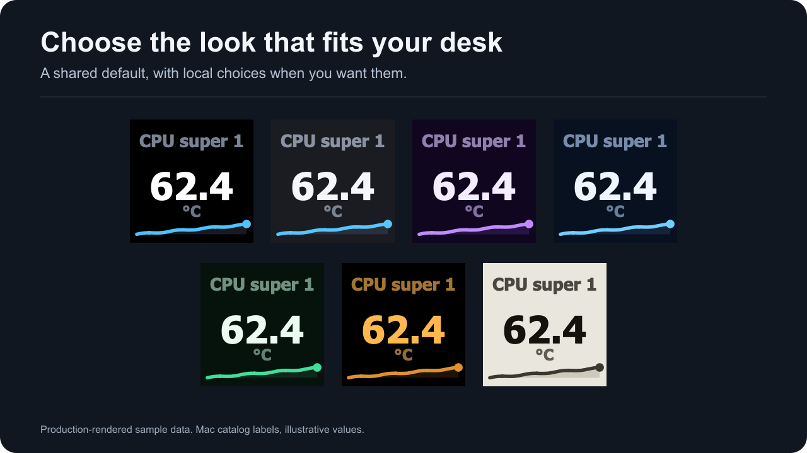
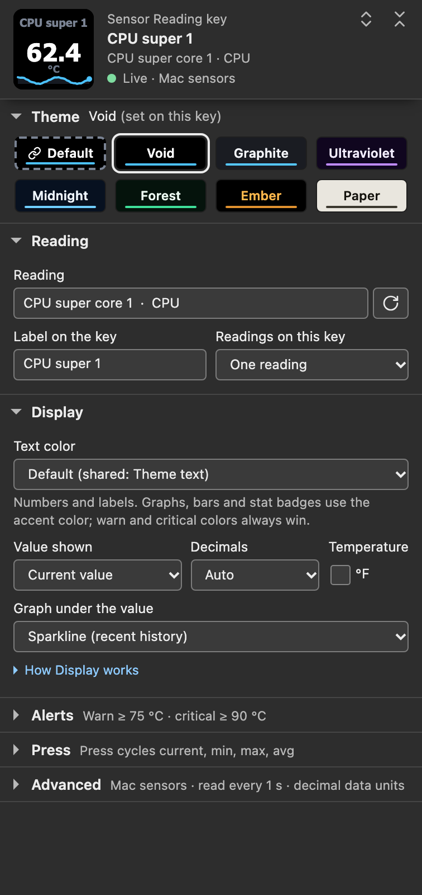
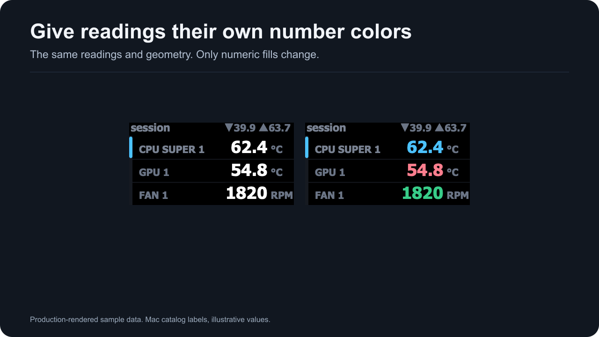

# Themes and colors

Pick a theme in the strip under a key's or dial's settings header. Choose **Default** to follow the shared theme, or a named preset for that key or dial only.

## The seven presets

*Production-rendered sample data: the CPU super core 1 reading with the custom label CPU super 1 and an illustrative value. Rendered with **Accent colors** set to Theme accent everywhere, so each sparkline shows its theme's own accent instead of the default temperature accent.*

| Theme | Background | Value text | Accent | Notes |
| --- | --- | --- | --- | --- |
| **Void** | `#000000` | `#FFFFFF` | `#4CC2FF` | Black with white values. The shared theme on a new install. |
| **Graphite** | `#1A1C22` | `#F4F6FA` | `#55C7FF` | Dark slate. |
| **Ultraviolet** | `#10061F` | `#F3EDFF` | `#C08BFF` | Dark violet with a lavender accent. |
| **Midnight** | `#071120` | `#EFF6FF` | `#6FCFFF` | Dark blue with a light blue accent. |
| **Forest** | `#05130C` | `#ECFBF2` | `#3FE09A` | Dark green with a green accent. |
| **Ember** | `#000000` | `#FFB84D` | `#E0912F` | Black with amber text and accents. |
| **Paper** | `#E9E6DE` | `#14120D` | `#3B382E` | Light with dark text. Keeps its own accent. |

A theme changes colors only: the layout, sizes and positions stay the same when you switch. Key status screens such as **Pick a sensor** draw on black in every theme. A dial's status and prompt faces use the dial's theme background, except the fixed **Tahoma needed** image, which is black on keys and dials. [Sensor Dial reading colors](#reading-colors-on-dials) can tell readings apart within one theme.

## Contrast

The built-in text colors are checked by calculation against their own backgrounds:

- With **Theme text** and **Dimmed**, values and units reach at least 4.5:1 on every theme, and labels are never dimmer than units.
- Theme value text reaches at least 12:1, and every theme accent at least 4:1.
- Every type accent reaches at least 4:1 on each theme it can appear on.
- Alert value text calculates to about 7.6:1 on the warning amber and about 5.6:1 on the critical red.

These floors do not cover a **Custom color** for text, or cell and reading colors you pick for a quad grid or a dial: those draw exactly as chosen. The automatic quad cell colors are lifted to 4.5:1 when needed.

Contrast is a calculation. Physical Stream Deck key checks are pending, so legibility on a device is not established; see [Hardware compatibility](hardware.html). Check a custom color on your own deck.

## Shared and per-key themes

Set the shared theme in **Advanced → Shared defaults → Theme**. It applies to every Mac Sensors key and dial set to **Default**, on every Stream Deck. The panel says so: *Used by every Mac Sensors key and dial, on every Stream Deck, that is set to Default. A key or dial with its own choice keeps it.*

A named preset stays local. One dial can keep Ember while the rest follow Midnight. On a key, the strip and **Text color** are described in [Sensor Reading](sensor-reading.html#theme); on a dial, in [Sensor Dial](sensor-dial.html#settings).

A new install starts with Void as the shared theme. If no shared theme was ever saved and the plugin finds existing settings at its first start, such as a profile with configured keys imported into a new install, the shared theme starts as Graphite instead. Pick any theme to replace it.

### Precedence

A key's or dial's own theme wins over the shared theme. Choose **Default** to make it follow again.

A stored theme name this version does not know, for example from a configuration document made by a newer version, draws Void and stays stored. The theme line shows it as unknown, such as *"neon" (unknown; draws Void)*, and the help under the strip says *This version does not know that theme; the key keeps it stored until you pick one.*

### The Default chip

**Default** follows the shared choice. Its chip shows the shared theme's colors with a dashed frame and a link mark, which set it apart from the preset it currently uses. The theme line says where the colors come from, such as **Default (shared: Void)** or **Ember (set on this key)**.

- **Change** opens the shared Theme setting.
- **Make shared** appears when this key's or dial's theme differs from the shared one. It makes that theme the shared theme first, then returns the key or dial to Default, so its look does not change. The theme line then reads **Default (shared: Ember)**, and a screen reader hears, for example, *Ember is now the shared theme, was Void. This key follows it.* If you pick another theme for the key while the shared settings save, the key keeps that newer choice.

Folding the strip keeps the chosen chip and its source on screen. A key with no reading shows the theme once a reading is picked; until then the strip's help says *Shows on the key once a reading is picked.*

*Settings-panel capture of the staged 1.0.1.0 panel in a simulated host with sample data and **Accent colors** set to **Theme accent everywhere**. Void is set on this key while the shared theme is also Void, so **Make shared** is hidden.*

## Text: Theme, Dimmed or Custom

Set **Display → Text color** for one key or dial, or **Advanced → Shared defaults → Text color** for the shared default.

| Choice | Result |
| --- | --- |
| **Default** | Follows the shared Text color. The option names it, such as **Default (shared: Theme text)**. Keys and dials only. |
| **Theme text** | The theme's text colors, even when the shared choice is Dimmed or Custom color. The shared default. |
| **Dimmed** | Values move 42 percent and labels, units and badges 30 percent toward the background. A value or unit that would fall below 4.5:1 is lifted back to it. |
| **Custom color** | The value uses your exact color. With **Dim labels, units and stats** ticked, labels, units and the stat badge use the same hue 35 percent closer to the background. Unticked *(default)*, every text element uses the exact color. |

Until you pick a custom color, theme text is drawn and the hex beside the well reads *not set: theme text until picked*; the well starts at the theme's value color. The shared choice has its own **Shared custom text color** and **Dim labels, units and stats**.

A valid custom color takes priority over quad cell colors, dial reading colors and detail tile colors. A custom color that is not a valid #RRGGBB value, for example from a pasted configuration document, draws theme text. Alerts take priority over every text choice.

Text and accents are separate. **Text color** changes numbers, labels and units. Sparklines, bars, rings and tracks keep their accent. The stat badge counts as text: it takes the accent with Theme text, a dimmed accent with Dimmed, and the custom color with Custom color.

The automatic quad cell colors are lifted for their background. Colors you pick for cells stay exact with Theme text and are only blended with Dimmed, so they can fall below the contrast floor.

## Text font

Faces use Tahoma Bold. **Advanced → Shared defaults** shows **Text font: Tahoma Bold**, and there is no second font to choose. The line under it reads *Tahoma Bold is used on every face.* A different font choice saved in the shared settings, for example by a configuration document, is kept and not used: the line then reads *Tahoma Bold is used. Your saved font setting is kept.* and the folded summary says *Tahoma (saved font kept)*.

Tahoma Bold ships with macOS and must be installed. The plugin asks macOS for the font named Tahoma-Bold on each read of the system counters. If that font does not resolve, keys show **Tahoma needed** / Open Font Book from a pre-rendered image, and dials show a matching setup image, instead of drawing readings in a substitute font. Install Tahoma Bold in Font Book, then choose **Check again**. See [Installation](installation.html).

## Type accents

**Advanced → Shared defaults → Accent colors → By sensor type** *(default)* colors sparklines, bars, rings and stat badges by reading category. Numbers, labels and units keep their Text color. **Theme accent everywhere** turns category accents off. The Sensor Reading panel says: *Accents color graphs, bars and stat badges, never the numbers (Text color does that). Paper keeps its own accent.* On a dial, numbers take type accents only with **Color numbers by sensor type** on; see [Reading colors on dials](#reading-colors-on-dials).

*Production-rendered sample data with **Accent colors** on **By sensor type**, the default.*

| Category | Accent | Mac readings in the measured M5 Pro catalog |
| --- | --- | --- |
| Temperature | Rose (`#FF7E8E`) | Every °C reading: CPU and GPU cores, Battery, NAND, Airport, Airflow left and right |
| Fan | Cyan (`#3FBEDD`) | Fan 1 and Fan 2 |
| Power | Gold (`#D4AB33`) | Watt readings: System Total, DC In and Battery |
| Load | Violet (`#B195FF`) | CPU usage |
| Network | Blue (`#6FA7FF`) | Every byte-rate reading: Network receive and send, and Storage read and write |
| Memory | Magenta (`#CE8BE0`) | Any reading whose label contains the word Memory: Memory total, free, active, inactive, wired and compressed |
| Clock | Green (`#38CD89`) | No Mac reading in this release |

Swap used, Startup volume total and available, and the DC In voltage and current keep the theme accent. Storage rates take the Network accent because the category comes from the unit. On a multi-reading key the accent follows the first reading.

**Paper always keeps its dark accent** (`#3B382E`), whatever **Accent colors** says.

## Reading colors on dials

The Sensor Dial's overview views, two rows and three rows, can give each reading its own number color under **Reading colors**: **Automatic**, **Signal (four hues)**, **Pairs (two hues)**, **Uniform**, or a color for each reading. A color belongs to the reading's identity, so reordering a rotation never moves it.

**Color numbers by sensor type** uses the type accents above for the numbers. It needs **Text color** on Theme text or Dimmed and **Accent colors** on By sensor type. A color you pick draws exactly with Theme text and is blended toward the background with Dimmed. A valid custom text color replaces reading colors, and warning and critical colors replace both. Details: [Sensor Dial](sensor-dial.html).

*Production-rendered sample data: Mac catalog readings, the first with the custom label CPU super 1, and illustrative values. Only the number colors differ. Rendered with **Accent colors** set to Theme accent everywhere.*

## Alert colors take priority

Set **Warn at** or **Critical at** in the Alerts section. The [threshold guide](thresholds.html) explains units, direction and examples.

| Level | Key background | Key value text | Dial bar fill | Dial overview value |
| --- | --- | --- | --- | --- |
| Warning | Amber (`#E8940D`) | Near black (`#1C1200`) | `#E8940D` | `#E8940D`, lifted to 4.5:1 on its row when needed |
| Critical | Red (`#CB2114`) | White (`#FFFFFF`) | `#CB2114` | `#FF3B30`, lifted to 4.5:1 on its row when needed |

A key recolors its whole face from the alert palette, background, labels, units, accent and track included, on every theme. A dial keeps its theme: the single view's bar fill takes the alert color, and an overview view colors the alerting row's value.

Custom text, type accents, quad cell colors and dial reading colors do not replace alert colors. Physical recognition across displays and color-vision differences has not been established.

## Where to go next

- [Sensor Reading](sensor-reading.html#theme): the theme strip and **Text color** on a key.
- [Sensor Dial](sensor-dial.html#reading-colors): reading colors and the dial's settings.
- [Thresholds and alerts](thresholds.html): when the alert colors appear.
