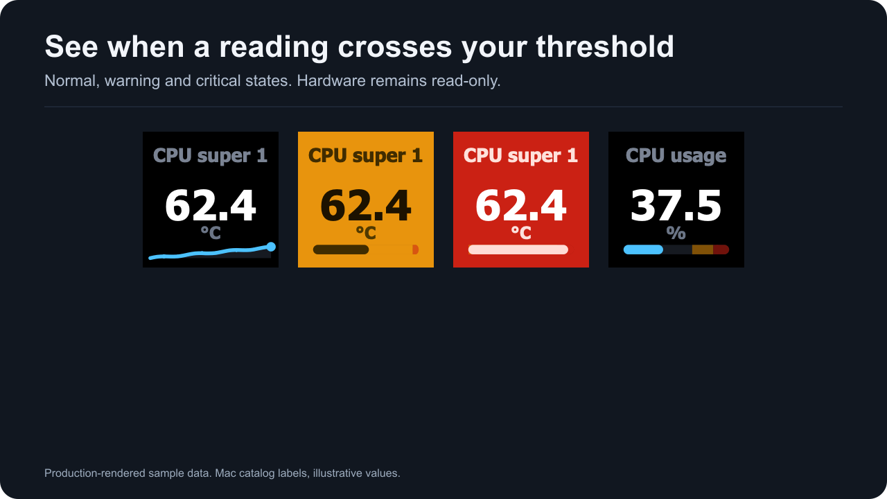

# Thresholds and alerts

Set warning and critical values for a reading. Choose the below-threshold direction when a low value is the problem. Thresholds use the displayed temperature unit when Fahrenheit is enabled.

*Production-rendered sample data. Warning and critical colors are fixed.*

Warnings use **#E8940D** and critical alerts use **#CB2114**. Alert colors override themes and custom numeric colors. Gauge zones are muted the same way they are on the device.

Pick thresholds for the specific quantity and Mac. A temperature threshold cannot describe fan speed, power or storage capacity. The plugin does not offer a universal hardware safety limit.

In a detail view, ordinary reading slots use their own reading and do not inherit a temperature alert rule from an unrelated opener. The Back tile represents the opener and keeps its alert presentation.

Dial thresholds are action settings. For a rotation set that mixes units, leave thresholds unset or use separate dials with limits suited to each quantity.

Alerts change what the plugin draws. They do not change fan speed, power limits or any sensor register.
