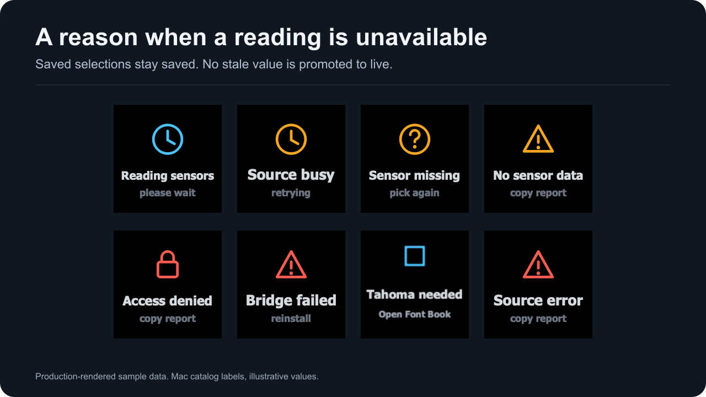
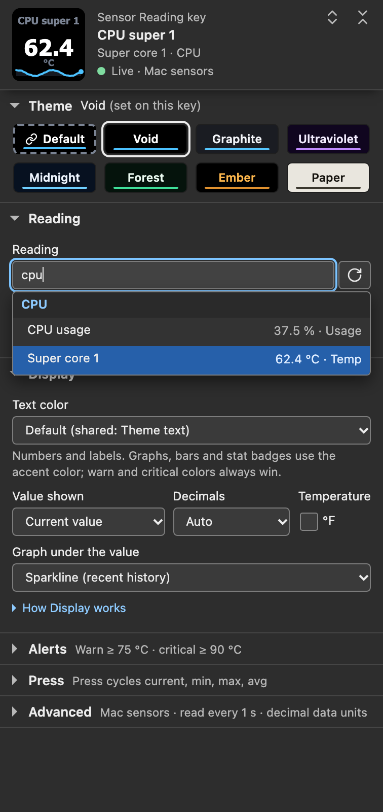

Start with the exact text on your key, dial or settings panel header. Mac Sensors reads this Mac directly; there is no separate sensor application to start or configure.

| What you see | Go to |
| --- | --- |
| Reading sensors | [Wait for the first read](#keys-show-reading-sensors) |
| Source busy | [Check the first read](#keys-show-source-busy) |
| No sensor data | [Check both sources](#keys-show-no-sensor-data) |
| Tahoma needed | [Install Tahoma Bold](#keys-show-tahoma-needed) |
| Bridge failed | [Reinstall the native reader](#keys-show-bridge-failed) |
| Source error | [Collect the evidence](#keys-show-source-error) |
| Needs macOS | [Check the runtime](#keys-show-needs-macos) |
| Sensor missing / pick again, or Sensor missing / waiting on a dial | [Check the saved reading](#keys-show-sensor-missing) |
| Access denied, Not updating | [Report it](#keys-show-access-denied-or-not-updating) |
| Pick a sensor, or Mac Sensors / rotate to pick on a dial | [Pick a reading](getting-started.html) |
| Saved reading not found (settings panel header) | [Check the saved reading](#keys-show-sensor-missing) |
| The plugin is not responding | [Restart the plugin](#the-panel-says-the-plugin-is-not-responding) |

For first-time setup, follow [Getting started](getting-started.html).

## How to read a status screen

When a key cannot show a current reading, it shows a two-line status screen. Dials use the same words in their title and value lines. The screen names the condition the plugin established; it may not identify the underlying cause. Saved settings never change because of a status screen.



*Production-rendered status screens with sample scenarios. Status screens use fixed colors, so the theme does not change them.*

| Key shows | Dial shows | Meaning |
| --- | --- | --- |
| **Reading sensors** / please wait | Reading sensors / please wait | The first read since reading started has not returned yet. |
| **Source busy** / retrying | Source busy / retrying | The first read has not finished after 15 seconds. |
| **No sensor data** / copy report | No sensor data / copy report | Both sources answered, but no reading is current. |
| **Tahoma needed** / Open Font Book | Tahoma needed / Open Font Book | Tahoma Bold was not found. Fixed image. |
| **Bridge failed** / reinstall | Bridge failed / reinstall | The native reader could not be used. |
| **Source error** / copy report | Source error / copy report | A read failed with no more specific cause. |
| **Needs macOS** / check requirements | Needs macOS / check requirements | The Node runtime that started the plugin is not macOS on arm64 or x86_64. |
| **Pick a sensor** / in settings | Mac Sensors / rotate to pick | No reading selected yet. |
| **Sensor missing** / pick again | Sensor missing / waiting | The selected reading is not reported right now. |

[Status screens](status-screens.html) has the panel sentence and buttons for each screen.

---

## Keys show Reading sensors

The first read after reading started has not returned yet. It clears when that read returns, with no action from you. Reading starts again when a page comes back after no Sensor Reading key, Sensor Dial or detail tile was visible for 2 seconds, so that page starts here too; a page change, opening details or Back inside those 2 seconds does not ([When reading starts and stops](data-sources.html#when-reading-starts-and-stops)).

It can also return during use if every reading lapses or fails before the session's first SMC read has answered. If it stays for more than 15 seconds:

1. Choose **Check again** in the key's settings.
2. If it still stays, copy a [support report](#copy-a-support-report) first, then quit and reopen the Stream Deck app, which restarts the plugin.
3. If it comes back, file an issue with the report and the [plugin log](#reading-the-plugin-log).

## Keys show Source busy

15 seconds after reading started, the first read has still not finished: no system counter read has succeeded and at least one source has not answered. The plugin has not checked the font yet.

1. Choose **Check again**. Each read asks the sources again; a source whose earlier call is still running is asked again once that call returns.
2. If it stays, copy a support report before anything else: it describes the running plugin, and a restart replaces it. Its `dataSource` section shows the reason, and its `mac` section shows how many readings each source returned (`sourceRows`) and any source error (`sourceErrors`). Until a source has been accepted the `mac` section says `catalog: "not sampled"`, and a read that failed without answering leaves no `sourceErrors` entry; the plugin log then has a `read failed; retrying.` line.
3. Then quit and reopen the Stream Deck app. A hardware call that is already running cannot be cancelled. Quitting and reopening the app starts a new plugin process; whether that clears a stuck call has not been tested.

## Keys show No sensor data

Both sources have answered, but no reading is current: every reading failed, was withheld as invalid, or expired.

1. **The Mac just woke from sleep.** After a sleep longer than 15 seconds every reading has expired, and this screen can show until the first read after waking returns. Wait for the next read. Real sleep and wake on hardware has not been checked yet; see [Sleep and wake](data-sources.html#sleep-and-wake).
2. **Both sources are failing.** Choose **Check again**. Look in the plugin log for `smc readings unavailable; other sources continue.`, `public readings unavailable; other sources continue.` or `read failed; retrying.` lines.
3. Copy a support report and file an issue with the log lines.

## Keys show Tahoma needed

On every system counter read, the native reader asks macOS for the font with the exact PostScript name Tahoma-Bold, with automatic font activation turned off. Any other answer, such as a substitute font, counts as missing. Readings are hidden while it is missing, because their text is fitted to Tahoma Bold. The **Tahoma needed** screen is stored as pixels, so it draws without the font, and the Back tile keeps its return arrow.

Tahoma Bold ships with macOS; on the measured macOS 27.0.1 it is in `/System/Library/Fonts/Supplemental`.

1. Open Font Book and search for Tahoma.
2. Make sure Tahoma Bold is installed and turned on. Install it if it is not listed.
3. Wait for the next read, at most one **Read every** interval while a Sensor Reading key, Sensor Dial or detail tile is visible, or choose **Check again** in the key's settings to read at once.

**Check again is not required.** The font check runs with every system counter read, so the screen clears on the first read after Tahoma Bold is available; **Check again** only makes that read happen now. The panel sentence still says "Install Tahoma Bold in Font Book, then choose Check again." Recovery after a real font install has been tested only with simulated reads; no system font was removed from the measured Mac.

Your readings, labels, colors and other settings stay as they were, and the same readings return. The panel header says **No sensor data** while this screen shows; the message under it gives the font instruction. Do not remove or replace system fonts to test this.

## Keys show Bridge failed

Before loading its native reader, the plugin checks it. When the Stream Deck app's Node runtime runs as arm64 it uses `bin/hwmac-arm64.node`, and as x86_64 it uses `bin/hwmac-x86_64.node`. The file's SHA-256 must match `bin/native-artifacts.json`, and its build information (protocol, version, source identity, Node-API level, architecture, macOS, not a test build) must match this plugin. **Bridge failed** means a check failed or macOS would not load the file. A load failure alone does not establish whether the file is damaged, missing or blocked.

The result is kept for the life of the plugin process.

1. Quit and reopen Stream Deck. The new plugin process checks the reader again.
2. If it persists, export a backup of your Stream Deck profiles, remove Mac Sensors as described in [Removing](installation.html#removing), then open the `.streamDeckPlugin` package again. Removing and reinstalling the same version has not been run on the measured Mac yet.
3. If the screen returns, copy a support report and file an issue. Include the package's SHA-256 from `shasum -a 256` and the release you got it from.

See also [Opening the same version again does nothing](#opening-the-same-version-again-does-nothing). Do not copy files over the installed plugin folder while the plugin is running.

The native files are ad-hoc signed. `codesign --verify --strict` checks a file's integrity; it is not a Developer ID or notarization check.

## Keys show Source error

A read failed in a way no other screen covers. Known causes: the native reader's clock returned no usable time, or both sources answered but the system counter read failed, so the font check that runs with it could not run. Every cause shows the same panel sentence.

1. Choose **Check again**.
2. If it stays, copy a support report first and keep the plugin log. The report gives the reason; the log can carry the source warnings listed under [Reading the plugin log](#reading-the-plugin-log).
3. Then quit and reopen the Stream Deck app.

## Keys show Needs macOS

The Node runtime that started the plugin is not macOS on arm64 or x86_64, so the plugin does not load its reader. With the runtime the Stream Deck app supplies, this screen is not expected; the package declares macOS only. Check [Installation and requirements](installation.html), then copy a support report: its `mac` section shows the platform and processor architecture the runtime reported.

## Keys show Sensor missing

A reading is selected, but this Mac does not report it right now. The saved identity no longer resolves in the latest read. The plugin never moves the key to a reading with a similar name or list position.

Causes, most lasting first:

1. **This Mac does not have that reading.** An SMC reading's identity includes the Mac model, so a selection saved on another model, or copied in a configuration document from another Mac, is missing here. An SMC key that this model does not have is never reported. See [Data sources](data-sources.html#reading-identity).
2. **Its last read failed or was withheld.** When the SMC read fails, the SMC readings drop out while the system counters keep working. When a system counter read fails after an earlier one succeeded, the system readings drop out and the SMC readings keep working. If no system counter read has succeeded since reading started, keys show **Source error**, or **Source busy** while a read is still out after 15 seconds, because the font has not been checked yet. A value outside its accepted range is withheld.
3. **It is a worked-out reading waiting for its pair.** CPU usage and the transfer rates show this for about a quarter second after reading starts, for one read after a sleep, and network rates for one read when an interface counter starts over at 4 GiB. See [Counter rebaseline](data-sources.html#counter-rebaseline).

The settings panel tells this apart from a source problem. Its header says **Saved reading not found**, and the message under it says the key keeps the saved reading with its label and colors and shows it again when this Mac reports it, with **Reload sensor list** and **Pick another reading** buttons.

**Fix:** for a temporary cause, wait; the reading returns by itself under the same identity. If the reading is gone for good, choose **Pick another reading** and select one from the list on this Mac. A dial shows **Sensor missing** / **waiting** and ignores turns while the reading is gone, so a dropout cannot move it off your saved pick.

## Keys show Access denied or Not updating

These two screens are defined, but no read in version 1.0.1 reports them. When the SMC service cannot be opened, the SMC readings are left out and the system counters keep working; a reading older than 15 seconds is removed rather than held. If you see either screen, copy a support report, keep the plugin log and file an issue.

## The panel says the plugin is not responding

The header reads **The plugin is not responding** when no answer comes within 3 seconds of the panel opening. The message under it says "The Mac Sensors plugin is not answering this panel. Settings you change here are still saved; restarting the Stream Deck app restarts the plugin." **Copy support report** changes to **Plugin not responding** when no report arrives within 3 seconds. Keys and dials can stop changing without any status screen.

This combination says the plugin is not answering the app. It does not identify why.

1. Quit and reopen the Stream Deck app.
2. Make sure the installed version is the current release.
3. If it happens again, keep the plugin log from before the restart (the older numbered file) and file an issue.

## The picker is empty

The **Reading** list shows the readings of the latest read, grouped by CPU, GPU, Memory, Storage, Network, Battery, Fans and System.



*Settings-panel capture of the staged 1.0.1.0 panel on a simulated host with sample readings and **Accent colors** set to **Theme accent everywhere**. It is not the Stream Deck app's own window.*

1. **A status screen is showing.** The message under the panel header names the cause, with **Check again** and **Sensor setup**. Fix that first.
2. **The search is too narrow.** The list then says `No readings match "…"` with your text. Clear the search box.
3. **The list has not loaded.** The reload button beside the search box ("Reload the sensor list") reloads the list from the latest read. **Check again** asks for a new read.
4. **The reading is not offered on any Mac.** CPU and GPU clocks, GPU usage, per-chip power and HID temperatures never appear. See [Data sources](data-sources.html#smc-readings).

## A reading is absent on this Mac

Available readings depend on the Mac model and macOS version:

- The SMC table has 61 candidate SMC keys. Every Mac is asked for 31 common SMC keys, Mac computers with Apple silicon for 4 more, and only the Mac17,9 with the t6050 chip for the 26 model-specific core and GPU temperatures. Keys that the SMC on this Mac does not have are left out. On the measured M5 Pro, 38 answer.
- On any other model the plugin log records `This model uses common typed sensors; its generation-specific catalog is not qualified.`
- A Mac without fans need not report fan readings.
- If the SMC service is missing or cannot be opened, every SMC reading is absent while system counters work. The log says `smc readings unavailable; other sources continue.` and the support report's `sourceErrors` names the step that failed.
- Network rates are one sum over the interfaces named `en` followed by a number; there is no reading for a single interface or drive.

For the state of Intel validation, see [Hardware compatibility](hardware.html). To ask for a reading on your Mac, file an issue with the model and chip from the support report.

## Values do not seem to update

Every read takes new measurements, and a reading older than 15 seconds is removed, never shown as current. A number that stays the same is usually a measurement that did not change. Check these:

1. **Read every is long.** At 5 seconds a key changes at most every 5 seconds. Change it under **Advanced**, **Connection**.
2. **The value is steady.** Memory total and Startup volume total rarely change. How often the SMC itself refreshes a key is unknown, and a register that stopped changing internally cannot be told apart from a steady one.
3. **The key is not visible.** Nothing is read while no Sensor Reading key, Sensor Dial or detail tile is visible anywhere, and after 2 seconds like that reading stops. A page you return to after that starts with **Reading sensors** and new sparklines; a page back within the 2 seconds continues where it was.
4. **The sparkline restarted.** It starts again when **Read every** changes, after a status screen, when its reading was missing, and when you return to a page after no Sensor Reading key, Sensor Dial or detail tile was visible anywhere for 2 seconds. It holds up to 36 points spaced by reads.
5. **The plugin is not answering.** See [The panel says the plugin is not responding](#the-panel-says-the-plugin-is-not-responding).

## A reading shows the wrong unit

Temperatures: each key and dial has its own **°F** checkbox under **Display**, **Temperature**. It changes only °C readings, and thresholds follow it. The sparkline is stored in °C and keeps its shape.

Bytes and rates: **Data units**, under **Advanced**, **Shared defaults**, applies to every key and dial. **Decimal (KB, MB, GB; rates in Mbps)** shows rates in bits per second; **Binary (KiB, MiB, GiB; rates in MiB/s)** shows bytes per second. Memory, swap and startup volume readings follow the same choice.

See [Temperature unit](sensor-reading.html#temperature-unit) and [Data units](sensor-reading.html#data-units).

## Thresholds do not fire

Check these first:

1. **The threshold unit.** **Warn at** and **Critical at** compare the current value in the reading's own unit: °F when **°F** is on. Byte and rate readings compare the source number in bytes or bytes per second, before **Data units** rescales the display. 100 Mbps is `12500000`; 8 GB is `8000000000`.
2. **The direction.** By default the alert fires at or above the number. For readings where low is bad, such as a fan or available space, tick **Alert when the value drops to or below these numbers (for fans and clocks)**.
3. **A key with several readings.** Only reading 1 is checked, and it recolors the whole key.
4. **A dial.** Warn, Critical and the bar ends apply only to readings in the unit that was on the dial when you last changed any of them, so a temperature limit never fires on a fan. Change a limit while the reading you want is on the dial.
5. **What an alert changes.** A dial stays in its theme: only the range bar's fill, or an overview row's value, turns amber or red. A key checks the live value even while it shows **MIN**, **MAX** or **AVG**, so a maximum past a limit does not color the key. See [Alerts on a dial](sensor-dial.html#alerts-on-a-dial).

A blank field turns that level off, and a decimal comma such as `70,5` is accepted. No alert shows while a status screen or **Sensor missing** shows. See [Thresholds and alerts](thresholds.html) and [Warn at and Critical at](sensor-reading.html#warn-at-and-critical-at).

## Detail view problems

**A press set to open details shows the Stream Deck alert triangle.** The plugin refused to open the view and left the key as it was:

- This deck type has no bundled detail profile. The key's **Press** section says *Sensor details are not available on this deck* with the model, and the log says `Detail entry refused: no bundled profile for device type` and a number.
- No sensor data is available and **Details list** is **Every reading from this reading's sensor** or **Readings matching a filter**. Only **A custom list** opens without data.
- The key has no reading selected, or, with **Every reading from this reading's sensor**, its reading is missing.
- **Readings matching a filter** has an empty **Filter**.
- A detail view is already open or opening on that deck.

**Nothing happens on the first press.** The Stream Deck app asks to install the deck's detail profile the first time. Until you accept, the deck stays where it is; the plugin drops that attempt after 30 seconds without a message. Press again after accepting.

**The view says No detail / selected.** The plugin restarted while the detail view was showing, so it no longer knows which reading opened it. Press the Back tile to return, then open the details again.

A development link does not install the bundled detail profiles. See [When a press does not open the page](sensor-details.html#when-a-press-does-not-open-the-page).

## Dial gestures do nothing

1. **The deck has no dials.** **Sensor Dial** needs a Stream Deck + or Stream Deck + XL encoder. Regular keys use **Sensor Reading**.
2. **No reading is picked yet.** A new dial shows **Mac Sensors** / **rotate to pick**. Turn it or pick a reading under **On the dial now** in the settings panel.
3. **Turns specifically do nothing.** Check whether **Ignore turns (protects against accidental bumps)** is ticked, whether the dial shows **pinned**, whether its reading is missing (**Sensor missing** / **waiting** holds the saved pick), whether a status screen shows, and, with **Gestures** set to **Custom**, whether **Turn** is **Do nothing**. The list under **Gestures** says what each gesture does now.

Synthetic gesture traces replay in software tests; checks of physical Stream Deck + dial gestures are pending. See [Dial controls and presets](dial-controls.html) and [Hardware compatibility](hardware.html).

## Mac Sensors is missing after install

1. **Look in the right category.** The actions list groups them under **Mac Sensors**: **Sensor Reading** and **Sensor Control** for keys, **Sensor Dial** for Stream Deck + dials.
2. **Check the requirements** in [Installation and requirements](installation.html). Update an older Stream Deck app.
3. **Check that it installed.** The installed plugin is the folder `~/Library/Application Support/com.elgato.StreamDeck/Plugins/com.lawrensen.mac.sdPlugin`.
4. **The same version was already installed.** See the next section.

Mac Sensors is not on the Elgato Marketplace yet. Install from the package as described in [Installation and requirements](installation.html).

## Opening the same version again does nothing

When the package's version equals the installed one, the Stream Deck app keeps the installed files and the running plugin, and its own log records `(AlreadyInstalled) Plugin 'Mac Sensors'`. That log is `~/Library/Logs/ElgatoStreamDeck/StreamDeck.log`; earlier app sessions are in `StreamDeck.1.log` and up. Opening the package again therefore cannot repair an installation.

To install the same version again, export a profile backup, remove Mac Sensors as described in [Removing](installation.html#removing), then open the package. To update, open the package of a newer version.

## High CPU, memory or a lingering process

The plugin runs one reader however many keys and dials are visible, and stops reading 2 seconds after none is (the log says `Stopped (no visible actions)`).

1. **High CPU at 250 ms.** At **Read every** 250 ms both sources are read four times a second and every changed face is drawn again. An earlier 1.0.1 candidate, measured as a development copy in the Stream Deck app on the M5 Pro with 32 single-reading keys, used 2.478% of one core at 250 ms against 0.668% at 1 second (PERF.md). Choose 1 second or longer under **Advanced**, **Connection**.
2. **Memory.** Over 24 hours with 32 single-reading keys at 1 second on the M5 Pro, the published 1.0.1.0, run as a development copy, peaked at 92.55 MiB of resident memory with 12 threads and 49 to 50 file descriptors (PERF.md). The earlier candidate peaked at 95.9 MiB in shorter sessions at 250 ms. If you see steady growth, note how many keys and dials are visible and the **Read every** value, and attach the log.
3. **A plugin process stays after the Stream Deck app quits.** The plugin checks for the app every 30 seconds. After two checks in a row find the app's process gone, it asks the app directly and exits if no answer comes within 15 seconds. The Stream Deck app starts its plugins when it launches; a real app restart with Mac Sensors has not been observed yet. If a Mac Sensors process keeps running well after that, keep the log and file an issue.


---

## Reading the plugin log

The Stream Deck app runs the plugin in its own folder, and the plugin writes its log there:

```
~/Library/Application Support/com.elgato.StreamDeck/Plugins/com.lawrensen.mac.sdPlugin/logs/
```

In Finder, choose **Go**, **Go to Folder** and paste the path. The newest file is `com.lawrensen.mac.0.log`. Each time the plugin starts, and when a file reaches 50 MiB, the files move up one number, up to `com.lawrensen.mac.9.log`. Each line is `TIMESTAMP LEVEL Scope: message`, for example:

```
2026-10-16T04:38:05.415Z INFO  MacSensors: Started (1000 ms interval)
2026-10-16T04:44:15.647Z INFO  MacSensors: Stopped (no visible actions)
```

Useful lines:

- `MacSensors: Started (… ms interval)` and `MacSensors: Stopped (no visible actions)`: the reader started for the first visible key or dial, and stopped 2 seconds after none was left. A page change inside those 2 seconds logs neither line.
- `MacSensors: Read interval set to … ms`: each effective **Read every** change.
- `MacSensors: smc readings unavailable; other sources continue.` (or `public`): a source answered with an error or with data that was already too old; its readings were removed and the other source kept serving.
- `MacSensors: smc read failed; retrying.` or `smc could not start; retrying.` (or `public`): a read did not complete or could not be queued.
- `MacSensors: Node is running under translation; sensor interfaces follow the detected hardware.`: macOS reports the Node process as translated.
- `MacSensors: This model uses common typed sensors; its generation-specific catalog is not qualified.`: this model gets the common SMC table.
- `Device connected: "…" (…, 8x4)` and `Device known: …`: one line per deck, with the name you gave it, its type and its key grid.
- `Detail entry refused: …`: why a detail press showed the Stream Deck alert triangle.
- `Parent probe failed […]`, `Parent watchdog disabled`, `watchdog standing down` and `Parent process gone, and the app did not answer: exiting.`: the check that ends the plugin when the Stream Deck app is gone. Report the exit line if the app is still running.
- `Uncaught exception` or `Unhandled rejection`: an unexpected error; please report it with the lines around it.

The `MacSensors` warnings are logged once each time the reader starts. In the 24-hour observation on the M5 Pro the log had no WARN or ERROR lines (PERF.md).

Developer switches use the `MACSENSORS_` prefix and are read from the environment the Stream Deck app gives the plugin at start; normal use needs none. `MACSENSORS_LOG_LEVEL` accepts `trace`, `debug`, `info` (the default), `warn` and `error`; at `debug` the log also records where each key and dial appeared. `trace` needs a debug launch of the plugin; otherwise the plugin uses `debug` and the log says so. `MACSENSORS_TRACE_EVENTS=1` writes redacted input traces to `logs/trace-<process id>.jsonl`.

The log names your decks as the Stream Deck app names them and can carry raw device and action identifiers, for example in `Detail entry refused: already active on …`. Review it before you share it.

## Copy a support report

In a Sensor Reading or Sensor Dial panel, open **Advanced**, then **Support**, and choose **Copy support report**. In a Sensor Control panel the button is under **Advanced**. The plugin builds the report on request and the panel copies it to the clipboard. The button then says **Copied to clipboard**, **Copy failed**, or **Plugin not responding** if no report arrived within 3 seconds, and returns to its label after 2 seconds. Nothing is uploaded.

The report is JSON with these parts:

| Part | Contents |
| --- | --- |
| `plugin`, `streamDeckApp`, `macOS` | Installed plugin version, Stream Deck app version and macOS version |
| `devices` | Each deck by model, type, key grid, encoders and touch strip, with a hashed identifier |
| `recentEvents` | The last 24 recorded dial and Sensor Control events, with hashed device and reading identities |
| `mac` | Node version, process architecture, platform, kernel release, the Node path with your home folder shown as `~`, Mac model, chip, Apple silicon, translation, and how many readings each source returned (`sourceRows`) with any source error (`sourceErrors`); `catalog: "not sampled"` before the first read |
| `dataSource` | Current state and reason, reading count, effective **Read every**, whether reading is running, how many actions keep it running, and the age of the oldest current reading |
| `sensorDial`, `control`, `detailNav` | Dial presets, views and set sizes, visible Sensor Control keys, and detail view state, by hashed identifiers |

How it reports the processor and translation:

- `processArchitecture` is `arm64` or `x64`, the architecture the app's Node runtime runs as. The plugin loads the matching native reader.
- `appleSilicon` is `true` when macOS reports the arm64 flag (`hw.optional.arm64`) as 1, `false` when it reports 0, and `null` when macOS has no such flag, as on the hosted Intel runner.
- `translation` is `native` when macOS says the process is not translated (`sysctl.proc_translated` is 0), or has no translation flag at all, as on an Intel Mac; `translated` when it reports 1; `unknown` for any other answer, with the error number in `translationError`. Before 1.0.1, Intel Mac computers reported `unknown`.
- `chip` is the chip identifier from the device tree on Apple silicon, for example `t6050`, and `unknown` where the device tree has no such entry.

The report leaves out sensor values, reading labels and names, deck names, raw device identifiers, your user name, serial numbers and hardware UUIDs. It also does not carry log lines, so attach the relevant log lines separately. Review the report before you post it.

## What stays on this Mac

- The plugin makes no internet requests and has no telemetry or update check of its own. Its only network connection is the Stream Deck SDK's WebSocket to the Stream Deck app at `127.0.0.1`, on the port the app assigns.
- Settings are stored by the Stream Deck app.
- The log and the support report stay on this Mac until you share them. The report reaches the clipboard only when you choose **Copy support report**.

See also [FAQ and privacy](faq.html#privacy).

---

## Before you file an issue

Check these first:

- The Mac meets the requirements in [Installation and requirements](installation.html); [Hardware compatibility](hardware.html) says what has been measured.
- You chose **Check again** once, and quit and reopened the Stream Deck app if the screen stayed.
- You picked the reading again if it is gone from this Mac for good.
- Threshold values use the displayed temperature unit, or bytes and bytes per second for byte and rate readings, and **Alert when the value drops to or below these numbers** is ticked where low is bad.

If it still fails, open a [public issue on the documentation repository](https://github.com/slawrensen/slawrensen.github.io/issues), name Mac Sensors in the title, and include:

1. **What you see**: the exact status text, for example "Source busy / retrying", or a photo of the key or dial.
2. **The installed plugin version**, from the support report's `plugin` field, and where you got the package.
3. **The Mac model, chip and macOS version**, from the support report.
4. **The Stream Deck app version and deck model**, for example Stream Deck +.
5. **Your Read every value**, and how many keys and dials are visible.
6. **The relevant log lines** from `com.lawrensen.mac.0.log`, especially any `MacSensors` warnings.
7. **The support report**, pasted into the issue after you review it.

Report security issues through the [private security-report form](https://github.com/slawrensen/slawrensen.github.io/security/advisories/new), naming Mac Sensors and the affected version. Do not post vulnerability details in a public issue.

## Where to go next

- [Status screens](status-screens.html) lists every screen with its panel sentence and buttons.
- [Data sources](data-sources.html) explains the two sources, freshness and sleep.
- [FAQ and privacy](faq.html) answers common questions, including what a support report contains.
